# BÁO CÁO NGHIÊN CỨU: HỆ SINH THÁI BẢO VỆ NGƯỜI DÙNG VÀ QUYỀN RIÊNG TƯ KIGUARD

---

## BẢNG MA TRẬN PHÂN BỔ SƠ ĐỒ HỆ THỐNG

| STT | Tên sơ đồ | Chuẩn mô hình | Vị trí xuất hiện | Mục đích phân tích |
| :---: | :--- | :---: | :--- | :--- |
| **1** | **Sơ đồ Tác nhân (Actor Diagram)** | UML Actor | **Chương 1 - Mục 1.2.1** | Mô hình hóa các nhóm thực thể tương tác với hệ thống. |
| **2** | **Sơ đồ Ca sử dụng Tổng thể** | UML Use Case | **Chương 1 - Mục 1.2.2** | Tổng quan chức năng các phân hệ Client Shield, Web Portal, Admin. |
| **3** | **Sơ đồ Ca sử dụng Phân rã** | UML Micro Use Case | **Chương 1 - Mục 1.2.3** | Đặc tả vi mô 17 Ca sử dụng (UC1 -> UC17). |
| **4** | **Sơ đồ Kiến trúc Phân tầng** | Architecture | **Chương 2 - Mục 2.1** | Mô tả cấu trúc các tầng dịch vụ (Client, Gateway, AI, Database). |
| **5** | **Sơ đồ Thực thể Quan hệ (ERD)** | ERD / NoSQL | **Chương 2 - Mục 2.2.3** | Thiết kế CSDL MongoDB (Nhúng Embedding vs Tham chiếu). |
| **6** | **Sơ đồ Tuần tự (Sequence Diagram)** | UML Sequence | **Chương 2 - Mục 2.5** | Trình diễn luồng tương tác Passkey, Fast Check URL, Report & RAG Chatbot. |
| **7** | **Sơ đồ Quy trình Nghiệp vụ (Activity)**| BPMN / Activity | **Chương 2 - Mục 2.6** | Phân chia 5 làn ranh giới trách nhiệm (Swimlanes) kiểm duyệt báo cáo. |
| **8** | **Sơ đồ Chuyển Trạng thái** | State Machine | **Chương 2 - Mục 2.7** | Mô tả vòng đời trạng thái của đơn báo cáo và tên miền độc hại. |

---

## CHƯƠNG 1: GIỚI THIỆU BÀI TOÁN VÀ PHÂN TÍCH YÊU CẦU

### 1.1. Giới thiệu Bài toán

#### 1.1.1. Bối cảnh Nghiên cứu
Trong kỷ nguyên chuyển đổi số quốc gia, không gian mạng trở thành môi trường hoạt động thiết yếu của cá nhân và tổ chức. Tuy nhiên, sự phát triển bùng nổ này kéo theo sự gia tăng phức tạp của các mối đe dọa an ninh mạng. Các hình thức tấn công lừa đảo trực tuyến (**Phishing**), mạo danh thương hiệu (Brand Impersonation), tên miền độc hại (**Scam URLs**) và thu thập dữ liệu cá nhân (**PII**) trái phép đang diễn ra với quy mô lớn, gây thiệt hại nghiêm trọng về tài sản và tâm lý xã hội.

Bên cạnh đó, người dùng trình duyệt web hàng ngày thường xuyên đối mặt với các nguy cơ rò rỉ quyền riêng tư tiềm ẩn:
1. **Tham số theo dõi tiếp thị ngầm (URL Tracking Parameters)**: Các đoạn mã `fbclid`, `gclid`, `utm_source` bám theo đường dẫn URL thu thập hành vi duyệt web qua nhiều nền tảng.
2. **Theo dõi vân tay trình duyệt (Browser Fingerprinting)**: Kỹ thuật khai thác thuộc tính Canvas, WebGL, AudioContext để nhận dạng thiết bị người dùng ngay cả khi đã xóa Cookie.
3. **Mất an toàn trong đăng nhập truyền thống**: Mật khẩu văn bản dễ bị lộ qua tấn công Phishing hoặc brute-force, thiếu giải pháp xác thực sinh trắc học hiện đại như **Passkey WebAuthn**.

#### 1.1.2. Vấn đề cần Giải quyết
Các giải pháp an ninh mạng hiện hành thường đối mặt với 3 thách thức lớn:
*   **Độ trễ kiểm tra cao**: Các công cụ chặn URL truyền thống phải truy vấn CSDL đĩa, gây giật lag trình duyệt (độ trễ $>300\text{ms}$).
*   **Thiếu bảo vệ quyền riêng tư tại biên (Client-side Privacy Protection)**: Dữ liệu nhạy cảm trên màn hình (Email, SĐT, Thẻ ATM, CCCD) không được làm mờ chủ động trước khi chụp ảnh chia sẻ hoặc rò rỉ qua các tiện ích mở rộng bên thứ ba.
*   **Hệ thống rời rạc, thiếu trợ giúp pháp lý**: Người dùng khi nghi ngờ trang web lừa đảo thiếu công cụ tra cứu tức thì và không có kênh hỗ trợ pháp lý Luật An ninh mạng tự động.

#### 1.1.3. Mục tiêu Hệ thống KiGuard Ecosystem
Đề tài **"Hệ sinh thái bảo vệ người dùng và đảm bảo quyền riêng tư KiGuard"** được nghiên cứu và phát triển nhằm xây dựng một giải pháp an ninh mạng toàn diện, bao gồm:
*   **Chrome Extension (Client Shield)**: Tự động đánh chặn URL độc hại thời gian thực với độ trễ $<50\text{ms}$ qua bộ lọc **RAM Cuckoo Filter**, tích hợp tính năng che mờ dữ liệu PII 5 cơ chế, xóa tham số theo dõi URL, dọn Cookie và định tuyến Proxy ẩn danh.
*   **Web Portal & Admin Dashboard**: Cổng thông tin hỗ trợ đăng nhập sinh trắc học **Passkey WebAuthn**, gửi báo cáo lừa đảo, tra cứu danh bạ Scammer Registry và bảng điều khiển kiểm duyệt dành cho Moderator/Admin.
*   **AI Service Subsystem**: Sử dụng Gemini LLM chấm điểm rủi ro website lừa đảo (AI Phishing Detector) và xây dựng Trợ lý ảo tư vấn Luật An ninh mạng với công nghệ **RAG (Retrieval-Augmented Generation)** trên CSDL FAISS Vector.
*   **Telegram Bot**: Cung cấp kênh tra cứu an toàn tên miền tức thì qua lệnh `/check <url>`.

---

### 1.2. Phân tích Yêu cầu và Mô hình hóa Ca sử dụng

#### 1.2.1. Xác định Tác nhân (Actor Identification)
Tác nhân (Actor) là các thực thể bên ngoài (con người hoặc hệ thống tự động) trực tiếp tương tác và trao đổi thông điệp với Hệ sinh thái KiGuard:

| Tác nhân (Actor) | Phân loại | Mô tả Vai trò và Quyền hạn trong Hệ thống |
| :--- | :---: | :--- |
| **`Guest`** (Khách vãng lai) | Con người | Người dùng truy cập Web Portal hoặc cài đặt Extension nhưng chưa đăng nhập tài khoản. Có quyền sử dụng công cụ quét URL ngầm, che mờ PII, tra cứu Scammer và hỏi đáp Chatbot RAG. |
| **`ExtUser`** (Người dùng Extension) | Con người | Người dùng tương tác trực tiếp với Chrome Extension Toolbar. Có quyền kích hoạt quét AI chuyên sâu, tùy chỉnh quy tắc mờ từ khóa, bật Proxy ẩn danh và dọn dẹp Cookie. |
| **`Registered User`** | Con người | Người dùng đã đăng ký/đăng nhập tài khoản trên Web Portal qua Email, Google OAuth2 hoặc Passkey. Có quyền gửi đơn báo cáo lừa đảo, theo dõi tiến trình đơn và gửi khiếu nại False Positive. |
| **`Moderator`** (Kiểm duyệt viên) | Con người | Thành viên ban quản trị có quyền truy cập Admin Dashboard (`RequireRole("moderator")`) để xem xét, phê duyệt hoặc từ chối các đơn báo cáo lừa đảo do người dùng gửi lên. |
| **`Super Admin`** (Quản trị hệ thống) | Con người | Quản trị viên tối cao có toàn quyền quản lý CSDL Blacklist/Allowlist, quản lý tài khoản Scammer Registry, xem báo cáo thống kê lưu lượng và cấu hình hệ thống. |
| **`AI Phishing Service`** | Hệ thống AI | Dịch vụ AI (FastAPI) tự động cào dữ liệu WHOIS, DNS records, cây DOM và gọi Gemini LLM tính toán điểm số rủi ro ($0 - 100\%$) cho các tên miền nghi ngờ. |
| **`AI Chatbot RAG`** | Hệ thống AI | Dịch vụ AI (FastAPI) thực hiện nhúng VectorEmbedding, truy vấn Cosine Similarity trên FAISS Vector DB và stream câu trả lời tư vấn Luật An ninh mạng 2018. |
| **`Telegram Bot Service`** | Hệ thống Bot | Dịch vụ Bot (Python) tiếp nhận câu lệnh `/check <url>` từ người dùng Telegram, giao tiếp với Backend Check API và phản hồi kết quả trực quan. |
| **`Crawler tự động`** | Hệ thống ngầm | Tiến trình cào dữ liệu tự động định kỳ thu thập danh sách đen chính thống (ChongLuaDao, Cổng thông tin Chính phủ) để nạp vào CSDL và Cuckoo Filter. |

---

#### 1.2.2. Phân nhóm và Xác định Ca sử dụng (Use Case Identification)

Dựa trên danh sách Tác nhân, các chức năng của hệ thống được phân nhóm rõ ràng theo từng phân hệ:

1.  **Nhóm Ca sử dụng dành cho Khách vãng lai (`Guest`) & Người dùng Extension (`ExtUser`)**:
    *   Quét URL độc hại thời gian thực & Kích hoạt quét AI chuyên sâu theo yêu cầu (`UC1`).
    *   Che mờ dữ liệu riêng tư PII trên trang web & hình ảnh với 5 cơ chế (`UC2`).
    *   Bảo mật kết nối Proxy mã hóa & Chống thu thập dấu vết số GPC / Fingerprint (`UC3`).
    *   Tự động xóa tham số theo dõi URL tiếp thị & Quản lý Cookie (`UC4`).
    *   Tra cứu an toàn tên miền qua Telegram Bot (`UC5`).
2.  **Nhóm Ca sử dụng dành cho Người dùng đã đăng nhập (`Registered User`)**:
    *   Đăng ký & Đăng nhập tài khoản bằng Email/Password mã hóa Bcrypt (`UC6`).
    *   Đăng nhập nhanh qua Google OAuth2 Single Sign-On (`UC7`).
    *   Đăng ký & Đăng nhập sinh trắc học không mật khẩu Passkey WebAuthn (`UC8`).
    *   Quản lý Hồ sơ cá nhân & Danh sách Thiết bị Passkey (`UC9`).
    *   Gửi đơn báo cáo liên kết/SĐT/STK lừa đảo kèm ảnh bằng chứng (`UC10`).
    *   Theo dõi tiến trình & Trạng thái xử lý đơn báo cáo (`UC11`).
    *   Tra cứu danh bạ lừa đảo Scammer Registry (`UC12`).
    *   Gửi khiếu nại gỡ chặn tên miền an toàn bị chặn nhầm False Positive (`UC13`).
    *   Hỏi đáp trực tiếp Trợ lý Luật An ninh mạng RAG qua WebSocket (`UC14`).
3.  **Nhóm Ca sử dụng dành cho Ban quản trị (`Moderator` & `Super Admin`)**:
    *   Kiểm duyệt, phê duyệt hoặc từ chối đơn báo cáo lừa đảo (`UC15`).
    *   Quản lý danh sách đen Blacklist & danh sách trắng Allowlist thời gian thực (`UC16`).
    *   Quản lý danh bạ Scammer Registry & Thống kê lưu lượng hệ thống (`UC17`).

##### Sơ đồ Ca sử dụng Tổng thể Hệ thống (Master Use Case Diagram):

```mermaid
flowchart TD
    subgraph Actors ["Tác nhân Hệ thống"]
        Guest["Khách vãng lai / ExtUser"]
        User["Người dùng Đăng nhập"]
        Mod["Kiểm duyệt viên Moderator"]
        Admin["Quản trị viên Super Admin"]
        BotUser["Người dùng Telegram Bot"]
    end

    subgraph ClientShield ["Phân hệ Client Shield & Bot"]
        UC1(["UC1: Quét URL & Quét AI"])
        UC2(["UC2: Che Mờ Dữ Liệu 5 cơ chế"])
        UC3(["UC3: Proxy & Chống Dấu vết GPC"])
        UC4(["UC4: Làm sạch URL & Auto Cookie"])
        UC5(["UC5: Tra cứu qua Telegram Bot"])
    end

    subgraph AuthWeb ["Phân hệ Xác thực & Web Portal"]
        UC6(["UC6: Xác thực Email/Password"])
        UC7(["UC7: Đăng nhập Google OAuth2"])
        UC8(["UC8: Xác thực Passkey WebAuthn"])
        UC9(["UC9: Quản lý Hồ sơ & Passkey"])
        UC10(["UC10: Gửi đơn báo cáo lừa đảo"])
        UC11(["UC11: Theo dõi trạng thái đơn"])
        UC12(["UC12: Tra cứu Scammer Registry"])
        UC13(["UC13: Khiếu nại gỡ chặn False Positive"])
        UC14(["UC14: Hỏi đáp Chatbot RAG Luật ANM"])
    end

    subgraph AdminPortal ["Phân hệ Quản trị Dashboard"]
        UC15(["UC15: Kiểm duyệt báo cáo Moderator"])
        UC16(["UC16: Quản lý Blacklist / Allowlist"])
        UC17(["UC17: Quản lý Scammer & Dashboard"])
    end

    Guest --> UC1 & UC2 & UC3 & UC4
    BotUser --> UC5
    User --> UC6 & UC7 & UC8 & UC9 & UC10 & UC11 & UC12 & UC13 & UC14
    Mod --> UC15
    Admin --> UC15 & UC16 & UC17
```

---

#### 1.2.3. Đặc tả Chi tiết Ca sử dụng (Use Case Specification)

Mỗi Ca sử dụng chính được mô tả chi tiết theo chuẩn UML, phân rã rõ ràng **Luồng xử lý chính (Main Success Scenario - Happy Path)** và **Luồng rẽ nhánh & Ngoại lệ (Alternative & Exception Flows - 4a, 4b, 5a...)**:

##### 1.2.3.1. Ca sử dụng UC1: Quét URL độc hại thời gian thực & Phân tích AI Phishing
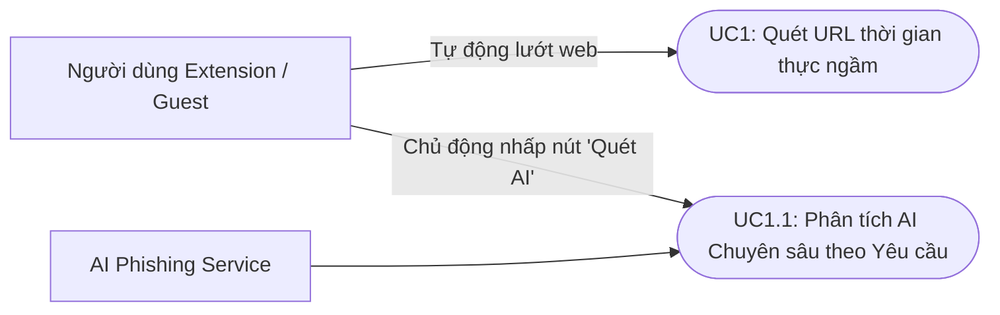
| Thuộc tính | Chi tiết đặc tả tiêu chuẩn UML |
| :--- | :--- |
| **Mã Ca sử dụng** | **`UC1`** |
| **Tên Ca sử dụng** | Quét URL độc hại thời gian thực (Real-time Malicious URL Inspection) |
| **Tác nhân chính** | `Guest` (Khách vãng lai), `ExtUser` (Người dùng Extension) |
| **Tác nhân phụ** | `Backend Check API` (Go Gin), `AI Phishing Service` (FastAPI) |
| **Tiền điều kiện** | Chrome Extension đã được cài đặt và bật cấp quyền `webNavigation` trên trình duyệt. |
| **Hậu điều kiện** | Trình duyệt truy cập trang an toàn hoặc bị ngắt kết nối và hiển thị màn hình cảnh báo đỏ. |
| **Luồng xử lý chính<br>(Happy Path - An toàn)** | 1. Người dùng nhập địa chỉ URL hoặc nhấp liên kết chuyển hướng trên trình duyệt.<br>2. Background Service Worker của Extension bắt sự kiện `onBeforeNavigate`, trích xuất domain/URL.<br>3. Extension gửi yêu cầu kiểm tra ngầm (`POST /check`) tới Backend Check Service.<br>4. Backend tra cứu bộ lọc xác suất **RAM Cuckoo Filter** và CSDL Allowlist ($<50\text{ms}$).<br>5. Backend xác nhận URL an toàn (`status: "SAFE"`), phản hồi kết quả về Extension.<br>6. Extension cho phép trình duyệt tiếp tục tải và hiển thị nội dung trang web bình thường. |
| **Luồng rẽ nhánh &<br>Ngoại lệ (Exceptions)** | **4a. Phát hiện trang web độc hại / lừa đảo (Unsafe URL):**<br>&nbsp;&nbsp;4a1. Cuckoo Filter hoặc CSDL Blacklist xác nhận URL là lừa đảo (`status: "UNSAFE"`).<br>&nbsp;&nbsp;4a2. Extension ngắt điều hướng, chuyển trang sang giao diện cảnh báo đỏ `kiguard_warning.html`.<br>&nbsp;&nbsp;4a3. Hiển thị điểm rủi ro, lý do cảnh báo và khuyến nghị người dùng không tiếp tục truy cập.<br>**4b. Người dùng chủ động yêu cầu Phân tích Chuyên sâu bằng AI (User-initiated AI Phishing Scan):**<br>&nbsp;&nbsp;4b1. Người dùng mở giao diện Popup của Extension hoặc Web Portal, nhấp vào nút **"Phân tích chuyên sâu bằng AI (AI Scan)"** đối với địa chỉ URL nghi ngờ.<br>&nbsp;&nbsp;4b2. Extension gửi yêu cầu `POST /check/ai-scan` chứa URL lên `AI Phishing Service` (FastAPI).<br>&nbsp;&nbsp;4b3. `AI Phishing Service` thực hiện cào dữ liệu WHOIS (tuổi tên miền), DNS records và cấu trúc cây DOM của trang web.<br>&nbsp;&nbsp;4b4. AI Service sử dụng Gemini LLM tính toán điểm số rủi ro (Risk Score 0-100%) và lập luận cảnh báo.<br>&nbsp;&nbsp;4b5. Trả kết quả phân tích chuyên sâu chi tiết về giao diện Extension cho người dùng xem xét. Nếu $Score \ge 70\%$, cho phép người dùng nhấp nút "Gửi báo cáo lừa đảo" hoặc "Thêm vào danh sách chặn".<br>**5a. Mất kết nối Mạng / Server quá tải (Fallback Mode):**<br>&nbsp;&nbsp;5a1. Yêu cầu kiểm tra bị quá hạn $2000\text{ms}$ hoặc trả về lỗi HTTP 5xx.<br>&nbsp;&nbsp;5a2. Extension kích hoạt Local Storage Cache Fallback, hiển thị biểu tượng cảnh báo vàng trên Extension Toolbar. |

##### 1.2.3.2. Ca sử dụng UC2: Che Mờ Dữ Liệu và Bảo vệ Quyền Riêng Tư (Data Blur Shield)
Phân hệ Che mờ dữ liệu được thiết kế theo kiến trúc phân rã 5 cơ chế bảo vệ linh hoạt (Tự động & Thủ công):

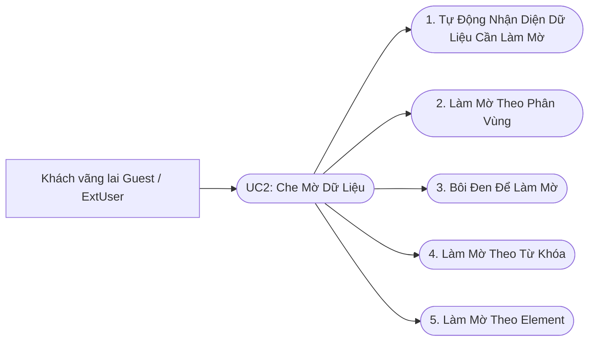

| STT | Cơ chế Che Mờ Dữ Liệu | Luồng xử lý chính (Main Success Scenario) | Ngoại lệ & Hậu điều kiện |
| :---: | :--- | :--- | :--- |
| **1** | **Tự Động Nhận Diện Dữ Liệu Cần Làm Mờ**<br>*(Auto PII Detection)* | 1. `MutationObserver` lắng nghe biến động cây DOM.<br>2. Engine Regex quét tìm chuỗi Email, SĐT, Số thẻ ngân hàng, Password.<br>3. Tự động bọc chuỗi nhạy cảm vào thẻ `<span class="kiguard-blurred">` mờ CSS (`filter: blur(5px)`). | Rê chuột (hover) vào vùng mờ để xem nội dung gốc trong 3 giây. |
| **2** | **Làm Mờ Theo Phân Vùng**<br>*(Area Drag-to-Blur)* | 1. Bật thanh công cụ Floating Toolbar, chọn chế độ khoanh vùng (Area Mode).<br>2. Nhấn giữ và kéo chuột vẽ hình chữ nhật đè lên vùng ảnh nhạy cảm (CCCD, Bằng lái).<br>3. Extension tạo thẻ `div` phủ CSS `backdrop-filter: blur(12px)` che đè vị trí tương đối. | Nhấp đúp chuột (Double click) vào vùng mờ để hủy lớp che ảnh. |
| **3** | **Bôi Đen Để Làm Mờ**<br>*(Text Selection Blackout)* | 1. Người dùng quét bôi đen một đoạn văn bản bất kỳ bằng con trỏ chuột.<br>2. Nhấp nút "Bôi đen làm mờ" trên thanh Context Menu / Quick Bar.<br>3. Extension chèn thuộc tính CSS `background-color: #000; color: transparent` che phủ chữ. | Khôi phục hiển thị khi nhấp nút Clear Selection. |
| **4** | **Làm Mờ Theo Từ Khóa**<br>*(Custom Keyword Blur Rules)* | 1. Người dùng cài đặt danh sách các từ khóa bí mật cá nhân trong Extension Option.<br>2. Content Script đối soát cây DOM với tập từ khóa cấu hình.<br>3. Tự động mờ tất cả các vị trí xuất hiện từ khóa bí mật trên trang web. | Hỗ trợ bật/tắt linh hoạt danh sách từ khóa theo từng trang web. |
| **5** | **Làm Mờ Theo Element**<br>*(DOM Element Picker Blur)* | 1. Chọn biểu tượng Con trỏ chọn phần tử (DOM Picker Tool).<br>2. Di chuột rê đến thẻ HTML bất kỳ (ảnh đại diện, khung chat, bảng dữ liệu).<br>3. Nhấp chuột trái để áp dụng ngay hiệu ứng mờ CSS đè lên toàn bộ thẻ HTML đó. | Lưu trạng thái mờ thẻ HTML theo địa chỉ URL trang web. |

##### 1.2.3.3. Ca sử dụng UC3: Bảo mật Kết nối Proxy & Chống Nhận dạng Dấu vết số (GPC & Proxy Anonymizer)
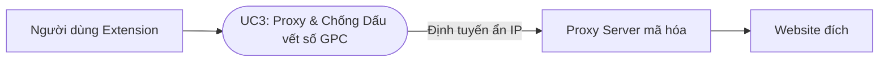
| Thuộc tính | Chi tiết đặc tả tiêu chuẩn UML |
| :--- | :--- |
| **Mã Ca sử dụng** | **`UC3`** |
| **Tên Ca sử dụng** | Bảo mật Kết nối Proxy & Chống Nhận dạng Dấu vết số (`ProxyAdvancedService`, `GpcService`, `AntibotService`) |
| **Tác nhân chính** | `ExtUser` |
| **Tác nhân phụ** | `Proxy Auth Server`, `Browser Network Engine` |
| **Tiền điều kiện** | Extension được cài đặt và kích hoạt chế độ "Ẩn danh nâng cao" (Anonymizer Mode). |
| **Luồng xử lý chính** | 1. Người dùng bật tính năng Proxy Anonymizer trên Extension Popup.<br>2. Service `ProxyAdvancedService` tự động cấu hình Chrome Proxy API định tuyến truy cập qua Server Proxy mã hóa.<br>3. `GpcService` tự động chèn HTTP Request Header `Sec-GPC: 1` (Global Privacy Control) gửi đến mọi website.<br>4. `AntibotService` xáo trộn tham số Canvas/WebGL Fingerprint ngăn website bên thứ ba thu thập dấu vết vân tay trình duyệt.<br>5. Địa chỉ IP thực và hành vi người dùng được bảo vệ ẩn danh tuyệt đối. |
| **Luồng rẽ nhánh** | **1a. Server Proxy yêu cầu xác thực:**<br>&nbsp;&nbsp;1a1. `ProxyAuthService` tự động gửi thông tin xác thực Token/Credentials ngầm mà không làm gián đoạn trải nghiệm người dùng. |

##### 1.2.3.4. Ca sử dụng UC4: Tự động Xóa Tham số Theo dõi URL & Quản lý Cookie
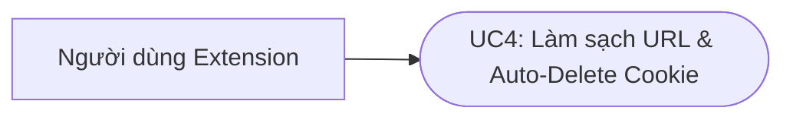
| Thuộc tính | Chi tiết đặc tả tiêu chuẩn UML |
| :--- | :--- |
| **Mã Ca sử dụng** | **`UC4`** |
| **Tên Ca sử dụng** | Tự động Xóa Tham số Theo dõi URL & Quản lý Cookie (`TrackingParamsService`, `CookieAutoDeleteService`) |
| **Tác nhân chính** | `ExtUser`, `Guest` |
| **Tiền điều kiện** | Trình duyệt thực hiện chuyển hướng liên kết chứa tham số theo dõi tiếp thị. |
| **Luồng xử lý chính** | 1. `TrackingParamsService` bắt sự kiện điều hướng URL.<br>2. Tự động bóc tách và xóa sạch các mã theo dõi ngầm trên URL như `fbclid`, `gclid`, `utm_source`, `utm_medium`, `utm_campaign`, `msclkid`.<br>3. Điều hướng trình duyệt tới địa chỉ URL sạch ban đầu.<br>4. Khi người dùng đóng Tab trình duyệt, `CookieAutoDeleteService` tự động xóa các Cookie theo dõi (Tracking Cookies) thuộc về tên miền đó. |
| **Luồng rẽ nhánh** | **3a. Tên miền thuộc White-list giữ Cookie:**<br>&nbsp;&nbsp;3a1. Giữ lại Cookie phiên đăng nhập đối với các trang web được người dùng đánh dấu tin tưởng. |

##### 1.2.3.5. Ca sử dụng UC5: Tra cứu an toàn tên miền qua Telegram Bot
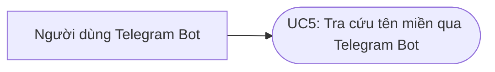
| Thuộc tính | Chi tiết đặc tả tiêu chuẩn UML |
| :--- | :--- |
| **Mã Ca sử dụng** | **`UC5`** |
| **Tên Ca sử dụng** | Tra cứu an toàn tên miền qua Telegram Bot (Telegram Bot Quick Check) |
| **Tác nhân chính** | `Guest`, `BotUser` |
| **Tác nhân phụ** | Telegram Bot Service (Python), Backend Check API |
| **Tiền điều kiện** | Người dùng mở ứng dụng Telegram và nhắn tin cho Bot KiGuard. |
| **Luồng xử lý chính** | 1. Người dùng gõ cú pháp tin nhắn `/check https://example-scam.com`.<br>2. Bot Service trích xuất URL và gọi Backend Check API (`POST /check`).<br>3. Backend kiểm tra và trả về thông tin trạng thái an toàn.<br>4. Bot gửi tin nhắn phản hồi HTML hiển thị mức độ rủi ro, tuổi tên miền và khuyến nghị an toàn. |
| **Luồng rẽ nhánh** | **1a. Cú pháp tin nhắn không hợp lệ:**<br>&nbsp;&nbsp;1a1. Người dùng gõ sai cú pháp hoặc không gửi kèm link URL.<br>&nbsp;&nbsp;1a2. Bot phản hồi hướng dẫn gõ đúng cú pháp: `/check <đường_dẫn_url>`. |

##### 1.2.3.6. Ca sử dụng UC6: Đăng ký & Đăng nhập tài khoản bằng Email
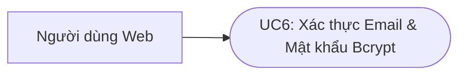
| Thuộc tính | Chi tiết đặc tả tiêu chuẩn UML |
| :--- | :--- |
| **Mã Ca sử dụng** | **`UC6`** |
| **Tên Ca sử dụng** | Đăng ký & Đăng nhập tài khoản bằng Email (Email/Password Authentication) |
| **Tác nhân chính** | `Registered User` |
| **Tác nhân phụ** | Backend Auth Service (Golang) |
| **Tiền điều kiện** | Truy cập trang Đăng nhập trên Cổng thông tin Web Portal. |
| **Luồng xử lý chính** | 1. Nhập Email và Mật khẩu trên biểu mẫu Đăng nhập.<br>2. Gửi request `POST /auth/login` tới Backend Auth.<br>3. Backend đối soát Email và xác minh mật khẩu mã hóa **Bcrypt** trong CSDL MongoDB.<br>4. Đúng thông tin, Backend khởi tạo và ký số Token **JWT RS256**.<br>5. Web Portal lưu JWT Token vào `localStorage` và chuyển hướng thành công vào Dashboard. |
| **Luồng rẽ nhánh** | **3a. Sai mật khẩu hoặc Email không tồn tại:**<br>&nbsp;&nbsp;3a1. Backend trả về lỗi HTTP 401 Unauthorized.<br>&nbsp;&nbsp;3a2. Web Portal hiển thị thông báo lỗi màu đỏ "Email hoặc mật khẩu không chính xác".<br>**3b. Nhập sai quá 5 lần (Rate Limiting Security):**<br>&nbsp;&nbsp;3b1. Khóa tạm thời tính năng đăng nhập trong 15 phút, trả về lỗi HTTP 429 Too Many Requests. |

##### 1.2.3.7. Ca sử dụng UC7: Đăng nhập nhanh qua Google OAuth2
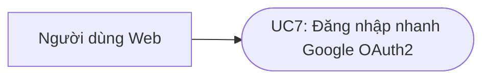
| Thuộc tính | Chi tiết đặc tả tiêu chuẩn UML |
| :--- | :--- |
| **Mã Ca sử dụng** | **`UC7`** |
| **Tên Ca sử dụng** | Đăng nhập nhanh qua Google OAuth2 (Google Single Sign-On) |
| **Tác nhân chính** | `Registered User` |
| **Tác nhân phụ** | Google Identity Service, Backend Auth |
| **Tiền điều kiện** | Người dùng có tài khoản Google hợp lệ. |
| **Luồng xử lý chính** | 1. Nhấp nút "Đăng nhập bằng Google" trên Web Portal.<br>2. Trình duyệt chuyển hướng tới Google OAuth2 consent screen.<br>3. Chấp thuận cấp quyền, Google trả OAuth Authorization Code về callback (`/auth/callback/google`).<br>4. Backend gửi Code sang Google Server đổi lấy ID Token, xác minh thông tin cá nhân.<br>5. Backend tự động tạo User mới trong MongoDB (nếu chưa có) và phát hành JWT Token RS256. |
| **Luồng rẽ nhánh** | **3a. Hủy xác thực trên Google:**<br>&nbsp;&nbsp;3a1. Google trả về Callback kèm lỗi `error=access_denied`.<br>&nbsp;&nbsp;3a2. Web Portal hiển thị thông báo "Đăng nhập Google bị hủy" và quay lại trang đăng nhập. |

##### 1.2.3.8. Ca sử dụng UC8: Đăng ký & Đăng nhập sinh trắc học Passkey
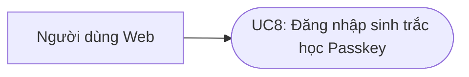
| Thuộc tính | Chi tiết đặc tả tiêu chuẩn UML |
| :--- | :--- |
| **Mã Ca sử dụng** | **`UC8`** |
| **Tên Ca sử dụng** | Đăng ký & Đăng nhập sinh trắc học Passkey (WebAuthn Passwordless Auth) |
| **Tác nhân chính** | `Registered User` |
| **Tác nhân phụ** | Trình duyệt WebAuthn API, Backend Auth |
| **Tiền điều kiện** | Thiết bị hỗ trợ cảm biến sinh trắc học (Vân tay TouchID, FaceID, Windows Hello). |
| **Luồng xử lý chính** | 1. Nhập Email, chọn "Đăng nhập bằng Passkey".<br>2. Backend gửi chuỗi $Challenge$ ngẫu nhiên qua API `POST /auth/passkey/login/begin`.<br>3. Trình duyệt gọi `navigator.credentials.get()`, kích hoạt hộp thoại quét sinh trắc học.<br>4. Chip bảo mật TPM dùng Private Key ký số $Challenge$, gửi chữ ký `POST /auth/passkey/login/finish`.<br>5. Backend đối soát chữ ký với Public Key trong CSDL MongoDB và phát hành JWT Token RS256. |
| **Luồng rẽ nhánh** | **3a. Thiết bị không hỗ trợ / Hủy quét sinh trắc học:**<br>&nbsp;&nbsp;3a1. Trình duyệt trả về lỗi `NotAllowedError` hoặc `NotSupportedError`.<br>&nbsp;&nbsp;3a2. Web Portal gợi ý chuyển sang Đăng nhập Mật khẩu truyền thống hoặc Google OAuth2.<br>**5a. Chữ ký số không hợp lệ:**<br>&nbsp;&nbsp;5a1. Backend trả về lỗi HTTP 400 Bad Request, từ chối đăng nhập. |

##### 1.2.3.9. Ca sử dụng UC9: Quản lý Hồ sơ & Thiết bị Passkey
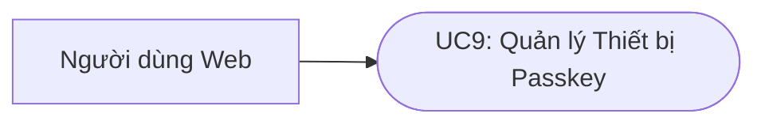
| Thuộc tính | Chi tiết đặc tả tiêu chuẩn UML |
| :--- | :--- |
| **Mã Ca sử dụng** | **`UC9`** |
| **Tên Ca sử dụng** | Quản lý Hồ sơ & Danh sách Thiết bị Passkey (User Profile & Credential Manager) |
| **Tác nhân chính** | `Registered User` |
| **Tiền điều kiện** | Người dùng đã đăng nhập thành công vào Web Portal. |
| **Luồng xử lý chính** | 1. Truy cập mục "Quản lý Tài khoản & Passkey" (`GET /users/me`).<br>2. Backend trả về thông tin hồ sơ và mảng `passkeys` nhúng trong CSDL MongoDB.<br>3. Hiển thị danh sách thiết bị Passkey (Tên ghi nhớ, Ngày đăng ký, AAGUID).<br>4. Cho phép người dùng đổi tên ghi nhớ thiết bị hoặc nhấp "Gỡ bỏ" thiết bị không sử dụng. |
| **Luồng rẽ nhánh** | **4a. Gỡ bỏ thiết bị Passkey duy nhất:**<br>&nbsp;&nbsp;4a1. Cảnh báo "Đây là Passkey duy nhất của bạn. Bạn nên thêm phương thức xác thực khác trước khi xóa."<br>&nbsp;&nbsp;4a2. Người dùng xác nhận đồng ý mới thực hiện xóa bản ghi khỏi CSDL. |

##### 1.2.3.10. Ca sử dụng UC10: Gửi đơn báo cáo liên kết/SĐT/STK lừa đảo
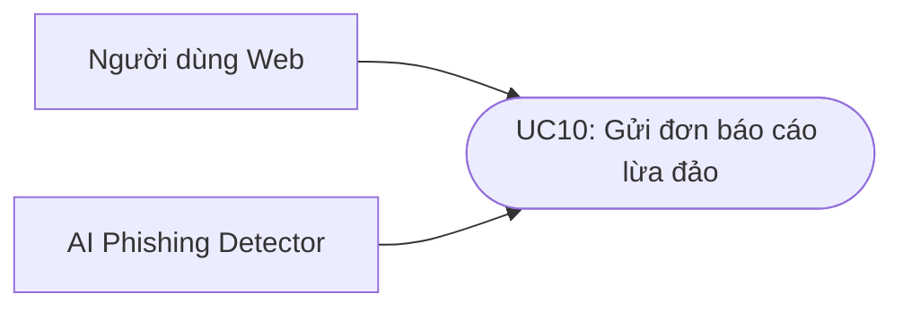
| Thuộc tính | Chi tiết đặc tả tiêu chuẩn UML |
| :--- | :--- |
| **Mã Ca sử dụng** | **`UC10`** |
| **Tên Ca sử dụng** | Gửi đơn báo cáo lừa đảo (Submit Scam Report) |
| **Tác nhân chính** | `Registered User` |
| **Tác nhân phụ** | `AI Phishing Service`, Backend Auth |
| **Tiền điều kiện** | Đã đăng nhập tài khoản Web Portal. |
| **Luồng xử lý chính** | 1. Người dùng mở form "Báo cáo Lừa đảo", nhập đối tượng (URL/SĐT/STK), mô tả và ảnh bằng chứng.<br>2. Nhấp "Gửi báo cáo", Web Portal gửi FormData qua `POST /reports`.<br>3. Backend ghi bản ghi đơn báo cáo vào CSDL MongoDB với trạng thái `status: "PENDING"`.<br>4. Kích hoạt sự kiện chạy ngầm đẩy sang `AI Phishing Service` cào WHOIS/DOM chấm Điểm rủi ro (0-100%).<br>5. Phản hồi thông báo "Gửi đơn thành công! Đơn đang chờ kiểm duyệt." kèm Mã đơn. |
| **Luồng rẽ nhánh** | **1a. Dung lượng ảnh vượt quá 5MB hoặc sai định dạng:**<br>&nbsp;&nbsp;1a1. Web Portal kiểm tra tại client, chặn gửi form và báo lỗi "Ảnh đính kèm tối đa 5MB". |

##### 1.2.3.11. Ca sử dụng UC11: Theo dõi tiến trình & Trạng thái đơn báo cáo

| Thuộc tính | Chi tiết đặc tả tiêu chuẩn UML |
| :--- | :--- |
| **Mã Ca sử dụng** | **`UC11`** |
| **Tên Ca sử dụng** | Theo dõi tiến trình & Trạng thái đơn báo cáo (Report Status Tracker) |
| **Tác nhân chính** | `Registered User` |
| **Tiền điều kiện** | Đã gửi ít nhất 1 đơn báo cáo lên hệ thống. |
| **Luồng xử lý chính** | 1. Truy cập mục "Lịch sử báo cáo của tôi" trên Web Portal (`GET /reports/my-reports`).<br>2. Backend truy vấn CSDL MongoDB theo `reporter_id`.<br>3. Hiển thị danh sách các đơn báo cáo kèm điểm AI gợi ý và trạng thái xử lý (`PENDING` - Chờ duyệt, `APPROVED` - Đã duyệt, `REJECTED` - Từ chối). |
| **Luồng rẽ nhánh** | **3a. Xem lý do đơn bị từ chối (`REJECTED`):**<br>&nbsp;&nbsp;3a1. Nhấp chi tiết đơn để xem lý do từ chối do Moderator nhập (ví dụ: "Bằng chứng chưa đủ cơ sở"). |

##### 1.2.3.12. Ca sử dụng UC12: Tra cứu danh bạ lừa đảo Scammer Registry
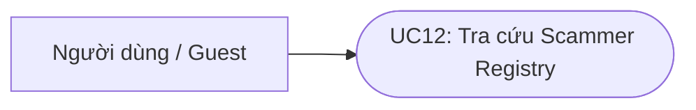
| Thuộc tính | Chi tiết đặc tả tiêu chuẩn UML |
| :--- | :--- |
| **Mã Ca sử dụng** | **`UC12`** |
| **Tên Ca sử dụng** | Tra cứu danh bạ lừa đảo Scammer Registry (Scammer Registry Lookup) |
| **Tác nhân chính** | `Registered User`, `Guest` |
| **Tiền điều kiện** | Truy cập trang Tra cứu An toàn trên Web Portal hoặc Extension. |
| **Luồng xử lý chính** | 1. Nhập từ khóa tìm kiếm (Số tài khoản, Số điện thoại, Tên miền).<br>2. Gửi request tra cứu `GET /scammers?query=...` tới Backend.<br>3. Backend tìm kiếm trong Collection `scammers` của CSDL MongoDB.<br>4. Trả về thông tin chi tiết số lần bị tố cáo, tổng số tiền lừa đảo liên quan.<br>5. Hiển thị bảng cảnh báo đỏ nổi bật chi tiết các vụ vi phạm. |
| **Luồng rẽ nhánh** | **4a. Không tìm thấy bản ghi (Từ khóa sạch):**<br>&nbsp;&nbsp;4a1. Backend trả về kết quả rỗng.<br>&nbsp;&nbsp;4a2. Hiển thị thông báo xanh: "Chưa ghi nhận báo cáo lừa đảo cho thông tin này. Vẫn nên cẩn trọng khi giao dịch." |

##### 1.2.3.13. Ca sử dụng UC13: Gửi khiếu nại gỡ chặn False Positive
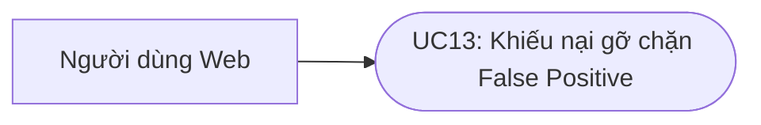
| Thuộc tính | Chi tiết đặc tả tiêu chuẩn UML |
| :--- | :--- |
| **Mã Ca sử dụng** | **`UC13`** |
| **Tên Ca sử dụng** | Gửi khiếu nại gỡ chặn False Positive (False Positive Appeal Submission) |
| **Tác nhân chính** | `Registered User` (Chủ sở hữu website bị chặn nhầm) |
| **Tiền điều kiện** | Website an toàn bị hệ thống đưa nhầm vào danh sách chặn. |
| **Luồng xử lý chính** | 1. Nhấp liên kết "Gửi khiếu nại gỡ chặn" trên trang thông báo chặn URL.<br>2. Nhập URL bị chặn, Email liên hệ, lý do giải trình và đính kèm tệp xác minh sở hữu tên miền.<br>3. Gửi đơn, Backend lưu bản ghi trạng thái `status: "APPEALED"` trong MongoDB.<br>4. Đẩy đơn vào hàng chờ ưu tiên cao trên Dashboard của Ban quản trị để xem xét gỡ chặn. |
| **Luồng rẽ nhánh** | **3a. Tên miền thuộc Danh sách đen Quốc gia chính thức:**<br>&nbsp;&nbsp;3a1. Backend kiểm tra URL nằm trong danh sách cấm tuyệt đối của Chính phủ.<br>&nbsp;&nbsp;3a2. Từ chối tạo khiếu nại tự động kèm thông báo lý do pháp lý. |

##### 1.2.3.14. Ca sử dụng UC14: Hỏi đáp trực tiếp Trợ lý Luật An ninh mạng RAG
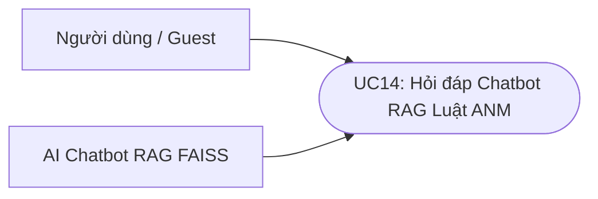
| Thuộc tính | Chi tiết đặc tả tiêu chuẩn UML |
| :--- | :--- |
| **Mã Ca sử dụng** | **`UC14`** |
| **Tên Ca sử dụng** | Hỏi đáp trực tiếp Trợ lý Luật An ninh mạng RAG (RAG Legal AI Chatbot) |
| **Tác nhân chính** | `Registered User`, `Guest` |
| **Tác nhân phụ** | `AI Chatbot Service` (FastAPI), FAISS Vector DB, Gemini LLM |
| **Tiền điều kiện** | Mở khung Chatbot trên Web Portal (kết nối WebSocket `/ws/chat`). |
| **Luồng xử lý chính** | 1. Gõ câu hỏi thắc mắc pháp lý (ví dụ: *"Bị lừa tiền qua mạng thì báo án ở đâu?"*).<br>2. AI Chatbot Service tạo Vector embedding 768 chiều từ câu hỏi.<br>3. Truy vấn Cosine Similarity trên **FAISS Vector DB**, trích xuất 3 đoạn Luật An ninh mạng liên quan.<br>4. Ghép ngữ cảnh luật vào Prompt RAG và gọi **Gemini LLM API** sinh câu trả lời.<br>5. Stream từng chuỗi văn bản qua WebSocket hiển thị câu trả lời tự nhiên kèm trích dẫn Điều luật. |
| **Luồng rẽ nhánh** | **3a. Không tìm thấy điều luật phù hợp trong Vector DB (Similarity < 0.4):**<br>&nbsp;&nbsp;3a1. Kích hoạt Fallback Prompt hướng dẫn nguyên tắc an toàn chung và số điện thoại đường dây nóng Công an. |

##### 1.2.3.15. Ca sử dụng UC15: Kiểm duyệt đơn báo cáo lừa đảo (Moderator Audit)
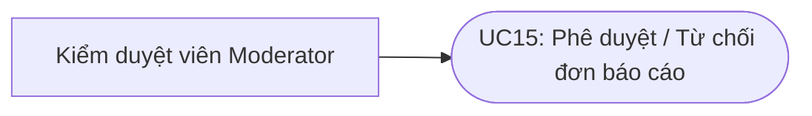
| Thuộc tính | Chi tiết đặc tả tiêu chuẩn UML |
| :--- | :--- |
| **Mã Ca sử dụng** | **`UC15`** |
| **Tên Ca sử dụng** | Kiểm duyệt đơn báo cáo lừa đảo (Moderator Report Audit) |
| **Tác nhân chính** | `Moderator`, `Admin` |
| **Tiền điều kiện** | Đăng nhập tài khoản có quyền `RequireRole("moderator")` trên Admin Dashboard. |
| **Luồng xử lý chính** | 1. Truy cập "Hàng chờ Kiểm duyệt" (`GET /admin/reports?status=PENDING`).<br>2. Xem thông tin đơn, ảnh chụp bằng chứng và Điểm rủi ro gợi ý từ AI (0-100%).<br>3. Kiểm duyệt viên nhấp nút "Phê duyệt" (`APPROVED`).<br>4. Backend cập nhật trạng thái đơn `APPROVED`, chèn URL vào Collection `scam_urls` MongoDB.<br>5. Tự động chèn URL vào **RAM Cuckoo Filter** thời gian thực mà không cần ngắt server. |
| **Luồng rẽ nhánh** | **3a. Kiểm duyệt viên từ chối đơn báo cáo (`REJECTED`):**<br>&nbsp;&nbsp;3a1. Nhấp "Từ chối" và bắt buộc nhập lý do từ chối (ví dụ: "Bằng chứng chưa đủ cơ sở").<br>&nbsp;&nbsp;3a2. Backend cập nhật đơn `REJECTED` kèm lý do, không chèn URL vào danh sách đen. |

##### 1.2.3.16. Ca sử dụng UC16: Quản lý Danh sách đen Blacklist & Danh sách trắng Allowlist
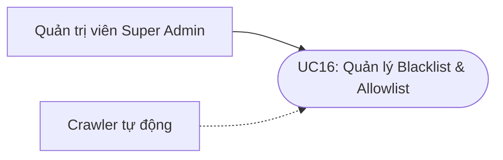
| Thuộc tính | Chi tiết đặc tả tiêu chuẩn UML |
| :--- | :--- |
| **Mã Ca sử dụng** | **`UC16`** |
| **Tên Ca sử dụng** | Quản lý Blacklist & Allowlist (Blacklist & Allowlist Management) |
| **Tác nhân chính** | `Super Admin` |
| **Tác nhân phụ** | `Crawler tự động`, Backend Check |
| **Tiền điều kiện** | Đăng nhập tài khoản Quản trị viên tối cao (Super Admin). |
| **Luồng xử lý chính** | 1. Truy cập mục "Quản lý Danh sách Tên miền" trên Admin Dashboard.<br>2. Thực hiện các thao tác CRUD (Thêm, sửa, xóa) bản ghi trong `scam_urls` và `allow_urls`.<br>3. Nhấp "Lưu thay đổi", Backend ghi dữ liệu vào CSDL MongoDB.<br>4. Backend phát lệnh Reload, tự động xây dựng lại bộ lọc **RAM Cuckoo Filter** thời gian thực. |
| **Luồng rẽ nhánh** | **2a. Đồng bộ dữ liệu cào tự động từ Crawler:**<br>&nbsp;&nbsp;2a1. Script Crawler chạy ngầm cào dữ liệu từ ChongLuaDao định kỳ.<br>&nbsp;&nbsp;2a2. Gọi API `POST /admin/sync-crawler` chèn bản ghi mới và tự động reload RAM Cuckoo Filter. |

##### 1.2.3.17. Ca sử dụng UC17: Quản lý Scammer Registry & Thống kê hệ thống
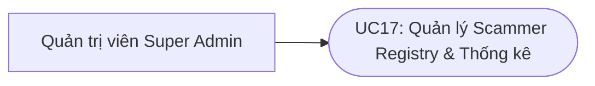
| Thuộc tính | Chi tiết đặc tả tiêu chuẩn UML |
| :--- | :--- |
| **Mã Ca sử dụng** | **`UC17`** |
| **Tên Ca sử dụng** | Quản lý Scammer Registry & Thống kê hệ thống (Scammer & Dashboard Management) |
| **Tác nhân chính** | `Super Admin` |
| **Tiền điều kiện** | Tài khoản Quản trị viên tối cao truy cập Admin Dashboard. |
| **Luồng xử lý chính** | 1. Quản lý CRUD các bản ghi thông tin lừa đảo trong Collection `scammers` (STK, SĐT, Ngân hàng).<br>2. Truy xuất Bảng điều khiển (`GET /admin/dashboard-stats`) xem biểu đồ trực quan lưu lượng quét URL.<br>3. Giám sát tỷ lệ lừa đảo bị chặn, top tên miền bị mạo danh và hoạt động của các Moderator.<br>4. Nhấp nút "Xuất báo cáo" để tải file thống kê định dạng Excel/CSV. |
| **Luồng rẽ nhánh** | **2a. Cảnh báo lưu lượng bất thường (Anomaly Traffic Warning):**<br>&nbsp;&nbsp;2a1. Hệ thống phát hiện IP gửi quá 1000 request/phút.<br>&nbsp;&nbsp;2a2. Dashboard hiển thị cảnh báo đỏ nổi bật và cho phép Admin nhấp một nút để Block IP tức thì. |

---

### 1.3. Yêu cầu Chức năng (Functional Requirements - FR)

Yêu cầu Chức năng mô tả danh sách các tính năng cụ thể mà Hệ thống KiGuard bắt buộc phải thực hiện:

#### 1.3.1. Chức năng Phân hệ Web Portal (`FR-WEB`)
1.  **Xác thực đa phương thức (`FR-WEB-01`)**: Cho phép người dùng đăng ký, đăng nhập bằng Email/Password mã hóa Bcrypt, Google OAuth2 Single Sign-On (`/auth/callback/google`), hoặc sinh trắc học Passkey WebAuthn (`/auth/passkey/login`).
2.  **Quản lý Hồ sơ & Thiết bị Passkey (`FR-WEB-02`)**: Cho phép xem, cập nhật thông tin cá nhân (`GET /users/me`), quản lý và gỡ bỏ thiết bị Passkey đã đăng ký.
3.  **Gửi & Theo dõi Đơn báo cáo (`FR-WEB-03`)**: Cho phép người dùng gửi đơn báo cáo URL/SĐT/STK lừa đảo kèm ảnh bằng chứng (`POST /reports`) và theo dõi tiến trình phê duyệt real-time.
4.  **Tra cứu Scammer Registry (`FR-WEB-04`)**: Cho phép tra cứu danh bạ tài khoản, số điện thoại, tên miền lừa đảo (`GET /scammers`).
5.  **Khiếu nại gỡ chặn False Positive (`FR-WEB-05`)**: Cho phép chủ sở hữu website bị chặn nhầm gửi đơn khiếu nại kèm giải trình tới Moderator.
6.  **Trợ lý Luật ANM Chatbot (`FR-WEB-06`)**: Kết nối WebSocket song công (`/ws/chat`), stream câu trả lời tư vấn Luật An ninh mạng 2018.

#### 1.3.2. Chức năng Client Shield Extension & Bot (`FR-EXT` & `FR-BOT`)
1.  **Quét URL thời gian thực (`FR-EXT-01`)**: Đánh chặn URL trước khi tải trang (`NavigationShield.js`), gọi API Backend Check (`POST /check`) nhận kết quả Fast Check $<50\text{ms}$ hoặc kích hoạt quét AI chuyên sâu theo yêu cầu.
2.  **Che mờ dữ liệu riêng tư (`FR-EXT-02`)**: Hỗ trợ 5 cơ chế che mờ PII (Tự động nhận diện PII Regex, Drag-to-blur mờ ảnh CCCD, Bôi đen làm mờ, Làm mờ từ khóa bí mật, Element Picker Blur).
3.  **Bảo vệ Kết nối Proxy & Chống Fingerprint (`FR-EXT-03`)**: Định tuyến Proxy mã hóa ẩn IP (`ProxyAdvancedService.js`), chèn Header `Sec-GPC: 1` (`GpcService.js`) và xáo trộn vân tay trình duyệt Canvas/WebGL (`AntibotService.js`).
4.  **Làm sạch URL & Tự động xóa Cookie (`FR-EXT-04`)**: Bóc tách xóa các tham số theo dõi tiếp thị `fbclid`, `gclid`, `utm_*` trên URL (`TrackingParamsService.js`) và tự động xóa Cookie theo dõi khi đóng Tab (`CookieAutoDeleteService.js`).
5.  **Quét an toàn qua Telegram Bot (`FR-BOT-01`)**: Tiếp nhận lệnh `/check <url>` qua ứng dụng Telegram và trả kết quả đánh giá an toàn tức thì.

#### 1.3.3. Chức năng Phân hệ Quản trị (`FR-ADM`)
1.  **Duyệt đơn báo cáo (`FR-ADM-01`)**: Hỗ trợ Moderator xem danh sách đơn (`GET /admin/reports`), duyệt (`APPROVED`) hoặc từ chối (`REJECTED`) dựa trên gợi ý của AI.
2.  **Quản lý Blacklist/Allowlist (`FR-ADM-02`)**: Cho phép Admin CRUD danh sách tên miền lừa đảo và tên miền an toàn, tự động kích hoạt nạp lại RAM Cuckoo Filter.
3.  **Quản lý Scammer Registry (`FR-ADM-03`)**: CRUD các bản ghi thông tin lừa đảo (`POST/DELETE /admin/scammers`).
4.  **Dashboard Thống kê hệ thống (`FR-ADM-04`)**: Hiển thị lưu lượng quét URL, tỷ lệ lừa đảo bị chặn, top tên miền bị mạo danh và danh sách IP rủi ro.

#### 1.3.4. Chức năng AI và Crawler Tự động (`FR-AI` & `FR-CRAWLER`)
1.  **Chấm điểm rủi ro AI Phishing (`FR-AI-01`)**: AI Phishing Service cào dữ liệu WHOIS, DNS, HTML DOM và gọi Gemini LLM tính điểm rủi ro ($0 - 100\%$).
2.  **Tìm kiếm tri thức Vector RAG (`FR-AI-02`)**: AI ANM Service phân mảnh, nhúng vector và tìm kiếm Cosine Similarity trên FAISS Vector DB.
3.  **Crawler & Đồng bộ RAM (`FR-CRAWLER-01`)**: Định kỳ cào danh sách đen chính thống, ghi MongoDB và nạp đè RAM Cuckoo Filter.

---

### 1.4. Yêu cầu Phi chức năng (Non-functional Requirements - NFR)

1.  **Hiệu năng & Độ trễ (Performance)**:
    *   Thời gian phản hồi Fast Check ngầm qua RAM Cuckoo Filter $<50\text{ms}$.
    *   Backend Check (Go Gin) chịu tải tối thiểu $1000\text{ req/s}$ đồng thời.
    *   Thời gian xử lý làm mờ PII tại client (Extension Content Script) $<10\text{ms}$.
    *   Thời gian chấm điểm AI Phishing $<2\text{s}$; Chatbot RAG stream phản hồi $<3\text{s}$.
2.  **Bảo mật & Kiểm soát (Security)**:
    *   Kích thước request body tối đa $1\text{MB}$; áp dụng Rate Limiting kép (100 req/phút toàn cục, 15 req/15 phút Auth).
    *   Mật khẩu người dùng được mã hóa bằng thuật toán **Bcrypt** ($Cost = 10$).
    *   Phiên làm việc JWT Token được ký số bằng chữ ký bất đối ứng **RSA RS256**.
    *   Xác thực sinh trắc học Passkey FIDO2 chống 100% rủi ro Phishing tài khoản quật.
    *   Phân quyền RBAC nghiêm ngặt (`RequireRole("admin")`, `RequireRole("moderator")`).
3.  **Tính Sẵn sàng & Khả dụng (Availability)**:
    *   Chỉ số thời gian hoạt động Uptime $\ge 99.9\%$.
    *   Trang bị cơ chế dự phòng **Fallback Mode** (trả Risk Score 50% hoặc Local Storage Cache) khi AI Service bị ngắt kết nối.
4.  **Quyền riêng tư tại biên (Privacy by Design)**:
    *   100% dữ liệu làm mờ PII được xử lý cục bộ trên máy client, tuyệt đối không gửi văn bản thô nhạy cảm về server.
5.  **Tương thích & Khả năng Mở rộng (Scalability & Compatibility)**:
    *   Tương thích trên các trình duyệt phổ biến (Chrome, Firefox, Edge).
    *   Giao diện Web Portal hiển thị tốt trên máy tính và thiết bị di động (Mobile Responsive).
    *   Backend Go và MongoDB dễ dàng mở rộng theo chiều ngang (Horizontal Scaling).

---

## CHƯƠNG 2: THIẾT KẾ HỆ THỐNG

### 2.1. Kiến trúc Tổng thể Hệ thống

Hệ thống KiGuard được thiết kế theo mô hình kiến trúc dịch vụ phân tầng (**Layered Microservices Architecture**):

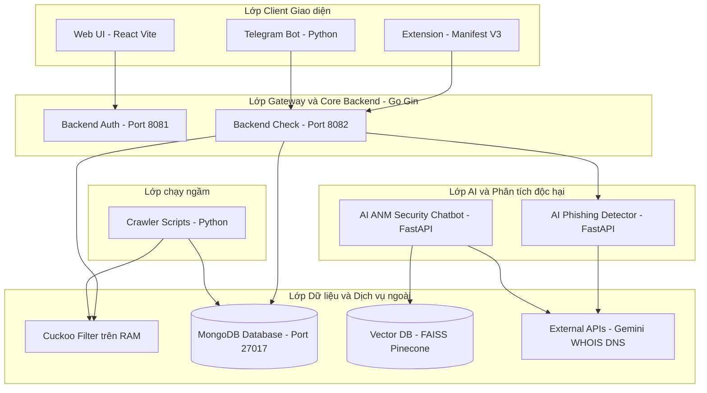

---

### 2.2. Thiết kế Cơ sở Dữ liệu (MongoDB)

#### 2.2.1. Danh sách các Collection MongoDB
Hệ thống sử dụng MongoDB làm CSDL chính với các Collection:
1.  `users`: Quản lý tài khoản, vai trò và thông tin thiết bị Passkeys.
2.  `scam_urls`: Danh sách đen các tên miền lừa đảo đã bị xác minh.
3.  `allow_urls`: Danh sách trắng các tên miền an toàn được miễn trừ.
4.  `reports`: Danh sách đơn báo cáo lừa đảo do người dùng gửi lên.
5.  `scammers`: Danh bạ thông tin tài khoản, số điện thoại lừa đảo.
6.  `check_logs`: Nhật ký các lượt kiểm tra URL (xử lý ghi log bất đồng bộ).

#### 2.2.2. Chiến lược Thiết kế (Embedding vs Referencing)
*   **Chiến lược Nhúng (Embedding)**: Sử dụng cho mảng `passkeys` bên trong Collection `users`. Do mỗi người dùng chỉ sở hữu tối đa vài thiết bị Passkey, việc nhúng trực tiếp giúp giảm chi phí `JOIN` CSDL, truy xuất 1 lần lấy toàn bộ Public Keys.
*   **Chiến lược Tham chiếu (Referencing)**: Sử dụng cho trường `reporter_id` trong Collection `reports` (trỏ về `users._id`). Giúp độc lập dung lượng bản ghi báo cáo và tránh giới hạn $16\text{MB}$ document của MongoDB.

#### 2.2.3. Sơ đồ Thực thể Quan hệ (ERD / NoSQL) & Từ điển Dữ liệu

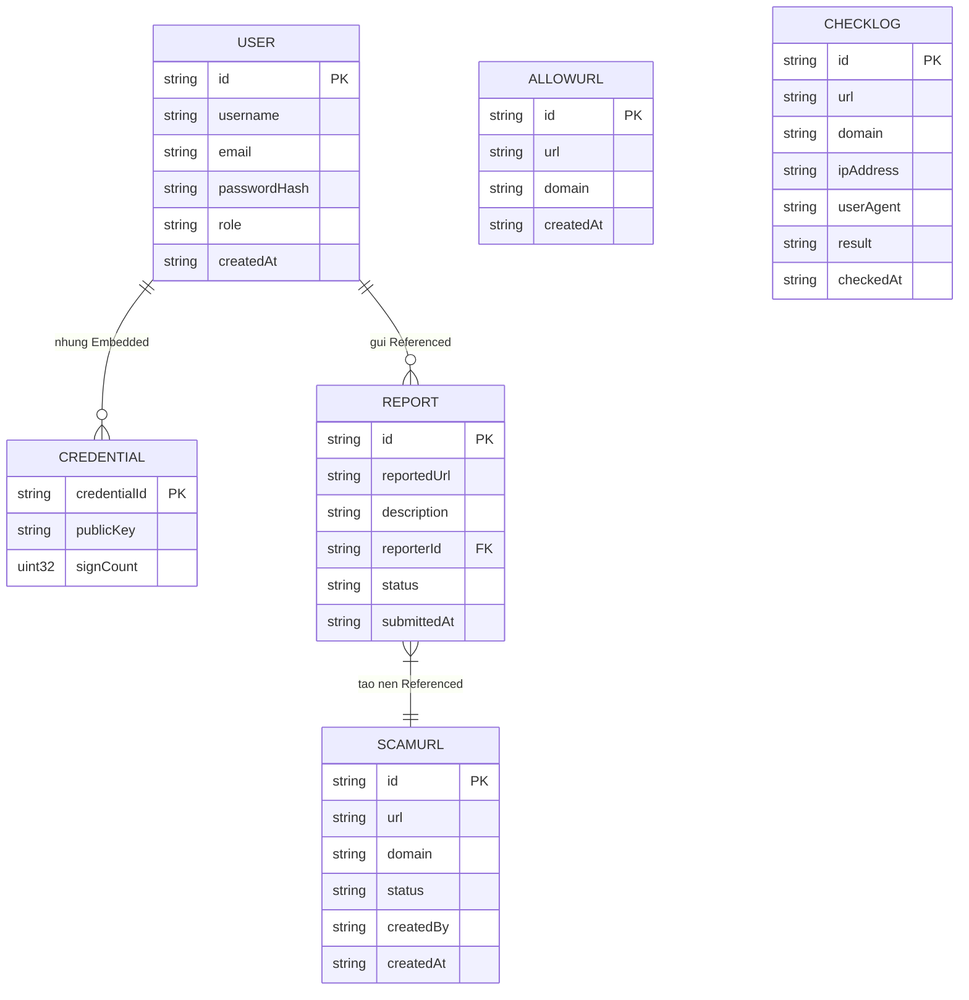

##### 1. Collection `users` (Quản lý Hồ sơ Tài khoản & Passkeys)
| Tên Trường | Kiểu Dữ Liệu | Ràng buộc | Giải thích Ý nghĩa Kỹ thuật |
| :--- | :---: | :---: | :--- |
| `_id` | `ObjectID` | Primary Key | Mã định danh duy nhất của người dùng. |
| `username` | `String` | Unique, Index | Tên tài khoản người dùng. |
| `email` | `String` | Unique, Index | Địa chỉ email đăng ký hệ thống. |
| `password_hash`| `String` | Bcrypt | Chuỗi mật khẩu mã hóa Bcrypt. |
| `role` | `String` | Enum | Vai trò: `super_admin`, `admin`, `moderator`, `user`. |
| `passkeys` | `Array[Object]`| Embedded | Danh sách thiết bị Passkey (`credential_id`, `public_key`, `sign_count`). |
| `created_at` | `DateTime` | Auto | Thời điểm tạo tài khoản. |

##### 2. Collection `scam_urls` (Danh sách Đen Tên miền Lừa đảo)
| Tên Trường | Kiểu Dữ Liệu | Ràng buộc | Giải thích Ý nghĩa Kỹ thuật |
| :--- | :---: | :---: | :--- |
| `_id` | `ObjectID` | Primary Key | Mã định danh bản ghi URL lừa đảo. |
| `url` | `String` | Index, Unique | Đường dẫn URL tuyệt đối bị xác minh lừa đảo. |
| `domain` | `String` | B-Tree Index | Tên miền gốc (Domain) phục vụ tra cứu nhanh. |
| `reason` | `String` | Required | Lý do vi phạm (Giả mạo ngân hàng, Phishing Facebook,...). |
| `threat_level` | `String` | Enum | Mức độ đe dọa: `CRITICAL`, `HIGH`, `MEDIUM`, `LOW`. |
| `created_by` | `String` | FK Reference | Mã Admin/Moderator/Crawler thêm URL vào. |
| `created_at` | `DateTime` | Index | Thời điểm thêm vào danh sách đen. |

##### 3. Collection `reports` (Đơn Báo cáo của Người dùng)
| Tên Trường | Kiểu Dữ Liệu | Ràng buộc | Giải thích Ý nghĩa Kỹ thuật |
| :--- | :---: | :---: | :--- |
| `_id` | `ObjectID` | Primary Key | Mã định danh đơn báo cáo. |
| `reported_url` | `String` | Required | Đường dẫn URL nghi ngờ lừa đảo. |
| `description` | `String` | Text | Mô tả chi tiết hành vi lừa đảo. |
| `reporter_id` | `ObjectID` | FK -> `users._id` | Mã người dùng gửi báo cáo (Tham chiếu). |
| `status` | `String` | Enum, Index | Trạng thái: `PENDING`, `APPROVED`, `REJECTED`, `APPEALED`. |
| `risk_score` | `Float` | 0.0 - 100.0 | Điểm rủi ro AI Phishing tự động chấm. |
| `ai_analysis` | `Object` | JSON Details | Chi tiết bằng chứng thô (WHOIS, DNS, DOM). |

##### 4. Collection `check_logs` (Nhật ký Quét URL Bất đồng bộ)
| Tên Trường | Kiểu Dữ Liệu | Ràng buộc | Giải thích Ý nghĩa Kỹ thuật |
| :--- | :---: | :---: | :--- |
| `_id` | `ObjectID` | Primary Key | Mã định danh bản ghi log. |
| `url` | `String` | Index | URL được người dùng gửi yêu cầu quét. |
| `domain` | `String` | Index | Tên miền tương ứng. |
| `ip_address` | `String` | Network IP | Địa chỉ IP Client thực hiện quét. |
| `user_agent` | `String` | Client Header | Thông tin trình duyệt/Extension. |
| `result` | `String` | Enum | Kết quả: `SAFE`, `UNSAFE`, `UNKNOWN`. |
| `checked_at` | `DateTime` | TTL Index | Thời điểm quét (Tự động xóa sau 90 ngày). |

#### 2.2.4. Đánh giá Lý do Lựa chọn MongoDB & RAM Cuckoo Filter
*   **MongoDB**: Phù hợp cho cấu trúc dữ liệu linh hoạt, hỗ trợ lưu trữ linh hoạt các thuộc tính bằng chứng thô (WHOIS, DNS, DOM) dạng JSON.
*   **RAM Cuckoo Filter**: Cấu trúc dữ liệu xác suất giúp tra cứu URL tồn tại trên RAM với thời gian $O(1)$, tiết kiệm $80\%$ bộ nhớ so với Bloom Filter thông thường và hỗ trợ thao tác xóa phần tử (Delete operation) mà không phải xây dựng lại toàn bộ bộ lọc.

---

### 2.3. Thiết kế API Hệ thống (RESTful API & WebSocket Specification)

#### 2.3.1. Nguyên tắc Thiết kế và Chuẩn hóa RESTful API

Hệ sinh thái KiGuard áp dụng các nguyên tắc chuẩn hóa RESTful API quốc tế và giao thức WebSocket song công:

1.  **Định dạng và Quy chuẩn Đặt tên URL**:
    *   Sử dụng tiền tố phiên bản API: `/api/v1/...` giúp dễ dàng nâng cấp bảo trì về sau.
    *   Tài nguyên (Resources) được đặt tên bằng danh từ số nhiều (ví dụ: `/users`, `/reports`, `/scammers`).
    *   Sử dụng chuẩn mã hóa ký tự **UTF-8** và định dạng trao đổi dữ liệu **JSON** (JavaScript Object Notation).
2.  **Động từ HTTP (HTTP Verbs Standard)**:
    *   `GET`: Truy xuất danh sách hoặc chi tiết tài nguyên (không làm thay đổi trạng thái hệ thống).
    *   `POST`: Tạo mới tài nguyên (đơn báo cáo, tài khoản, quét URL, xác thực Passkey).
    *   `PUT` / `PATCH`: Cập nhật toàn bộ hoặc một phần bản ghi thông tin.
    *   `DELETE`: Xóa tài nguyên (xóa Passkey, gỡ bỏ URL khỏi danh sách đen).
3.  **Mã Trạng thái Phản hồi (HTTP Status Codes)**:
    *   `200 OK`: Yêu cầu xử lý thành công, trả về dữ liệu.
    *   `201 Created`: Tạo mới bản ghi tài nguyên thành công (như gửi đơn báo cáo).
    *   `400 Bad Request`: Dữ liệu đầu vào sai cấu trúc hoặc thiếu các trường bắt buộc.
    *   `401 Unauthorized`: Token JWT RS256 hết hạn hoặc không có quyền truy cập.
    *   `403 Forbidden`: Người dùng không có vai trò hợp lệ (`RequireRole`).
    *   `429 Too Many Requests`: Vi phạm giới hạn tần suất Rate Limiting (chống DDoS).
    *   `500 Internal Server Error`: Lỗi hệ thống nội bộ backend.
4.  **Cơ chế Bảo mật Request & Streaming**:
    *   Xác thực bằng HTTP Request Header: `Authorization: Bearer <JWT_RS256_Token>`.
    *   Kết nối thời gian thực song công bằng giao thức mã hóa WebSocket: `wss://.../ws/chat`.

---

#### 2.3.2. Danh sách Tổng quan các API Endpoints (Master API Table)

| Phân hệ | Phương thức | Đường dẫn API Endpoint | Quyền hạn truy cập | Mô tả Chức năng và Đầu ra |
| :--- | :---: | :--- | :---: | :--- |
| **Auth** | `POST` | `/api/v1/auth/login` | Public | Đăng nhập Email/Password, trả về Token JWT RS256. |
| **Auth** | `POST` | `/api/v1/auth/passkey/login/begin` | Public | Khởi tạo $Challenge$ xác thực sinh trắc học Passkey. |
| **Auth** | `POST` | `/api/v1/auth/passkey/login/finish` | Public | Xác minh chữ ký số Passkey, cấp Token JWT RS256. |
| **Auth** | `GET` | `/api/v1/users/me` | Bearer Token | Lấy thông tin hồ sơ người dùng & danh sách Passkeys. |
| **Check** | `POST` | `/api/v1/check` | Public / Ext | Fast Check URL ngầm qua RAM Cuckoo Filter ($<50\text{ms}$). |
| **Check** | `POST` | `/api/v1/check/ai-scan` | Ext / User | Yêu cầu phân tích chuyên sâu bằng AI Phishing Service. |
| **Report**| `POST` | `/api/v1/reports` | Bearer Token | Gửi đơn báo cáo URL/SĐT/STK lừa đảo kèm ảnh chứng cứ. |
| **Report**| `GET` | `/api/v1/reports/my-reports` | Bearer Token | Truy xuất danh sách đơn báo cáo cá nhân của người dùng. |
| **Scammer**| `GET` | `/api/v1/scammers` | Public | Tra cứu danh bạ tài khoản, SĐT, tên miền lừa đảo. |
| **Admin** | `GET` | `/api/v1/admin/reports` | Moderator | Lấy danh sách đơn chờ duyệt (`PENDING`) cho Moderator. |
| **Admin** | `POST` | `/api/v1/admin/reports/:id/audit` | Moderator | Moderator phê duyệt (`APPROVED`) hoặc từ chối đơn. |
| **Admin** | `GET` | `/api/v1/admin/dashboard-stats` | Super Admin | Thống kê lưu lượng quét, tỷ lệ lừa đảo bị chặn. |
| **AI RAG** | `WebSocket`| `/ws/chat` | Public | Kết nối song công stream câu trả lời tư vấn Luật ANM. |

---

#### 2.3.3. Đặc tả Chi tiết Payloads Request & Response các API Tiêu biểu

##### 1. API Fast Check URL siêu tốc (`POST /api/v1/check`)
*   **Mục đích**: Tiện ích Chrome Extension gọi ngầm kiểm tra URL độc hại trước khi người dùng tải trang web.
*   **Request Header**: `Content-Type: application/json`
*   **Request Body**:
    ```json
    {
      "url": "https://facebook-login-verify-account.com/login.php",
      "client_version": "2.1.0"
    }
    ```
*   **Response Header**: `HTTP/1.1 200 OK`
*   **Response Body (Phát hiện trang web lừa đảo - Blacklist Hit)**:
    ```json
    {
      "status": "UNSAFE",
      "risk_score": 98.5,
      "threat_level": "CRITICAL",
      "category": "PHISHING_BANK_IMPERSONATION",
      "reason": "Tên miền nằm trong danh sách đen lừa đảo mạo danh mạng xã hội.",
      "cuckoo_hit": true,
      "latency_ms": 16.4
    }
    ```
*   **Response Body (Trang web an toàn)**:
    ```json
    {
      "status": "SAFE",
      "risk_score": 5.0,
      "threat_level": "LOW",
      "reason": "Địa chỉ an toàn, không phát hiện vi phạm.",
      "latency_ms": 12.1
    }
    ```

---

##### 2. API Yêu cầu Phân tích AI Phishing Chuyên sâu (`POST /api/v1/check/ai-scan`)
*   **Mục đích**: Người dùng chủ động nhấp nút "Phân tích chuyên sâu AI" trên Extension để cào bằng chứng WHOIS, DNS và DOM.
*   **Request Body**:
    ```json
    {
      "url": "https://vietcombank-online-banking-security.xyz"
    }
    ```
*   **Response Body (Chi tiết Bằng chứng thô từ AI Service)**:
    ```json
    {
      "url": "https://vietcombank-online-banking-security.xyz",
      "domain": "vietcombank-online-banking-security.xyz",
      "risk_score": 94.0,
      "ai_analysis": {
        "domain_age_days": 3,
        "whois_registrar": "NameCheap Inc.",
        "dns_ip": "185.220.101.5",
        "ssl_issuer": "Let's Encrypt",
        "dom_similarity": {
          "target_brand": "Vietcombank",
          "form_action": "http://185.220.101.5/steal.php",
          "has_fake_login_button": true
        },
        "llm_reasoning": "Tên miền mới đăng ký 3 ngày, sử dụng từ khóa giả mạo ngân hàng Vietcombank, chứa biểu mẫu gửi thông tin tài khoản về IP rủi ro."
      }
    }
    ```

---

##### 3. API Đăng nhập Sinh trắc học Passkey WebAuthn (`POST /api/v1/auth/passkey/login/finish`)
*   **Mục đích**: Gửi chữ ký số sinh trắc học từ chip TPM/WebAuthn API lên Backend Auth đối soát Public Key.
*   **Request Body**:
    ```json
    {
      "email": "admin@kiguard.vn",
      "credential": {
        "id": "eW91cl9jcmVkZW50aWFsX2lkX2hlcmU",
        "rawId": "eW91cl9jcmVkZW50aWFsX2lkX2hlcmU",
        "type": "public-key",
        "response": {
          "authenticatorData": "SZYN5YgOJGh0NB...",
          "clientDataJSON": "eyJ0eXBlIjoid2ViYXV0aG4uZ2V0...",
          "signature": "MEUCIQDx41Kk2W..."
        }
      }
    }
    ```
*   **Response Body**:
    ```json
    {
      "message": "Xác thực sinh trắc học Passkey thành công!",
      "access_token": "eyJhbGciOiJSUzI1NiIsInR5cCI6IkpXVCJ9...",
      "token_type": "Bearer",
      "expires_in": 86400,
      "user": {
        "id": "6648da3b744f434a",
        "email": "admin@kiguard.vn",
        "role": "super_admin"
      }
    }
    ```

---

##### 4. API Gửi Đơn Báo cáo Lừa đảo (`POST /api/v1/reports`)
*   **Mục đích**: Người dùng gửi đối tượng lừa đảo (URL/SĐT/STK) kèm mô tả và ảnh bằng chứng.
*   **Request Header**: `Authorization: Bearer <Token_JWT>`, `Content-Type: multipart/form-data`
*   **Form Data Fields**:
    *   `reported_url`: `https://scam-bank-transfer.com`
    *   `description`: `Trang web lừa đảo chiếm đoạt tài sản qua mã QR giả mạo.`
    *   `evidence_image`: `[File Binary Image .png/.jpg <= 5MB]`
*   **Response Body (`HTTP 201 Created`)**:
    ```json
    {
      "report_id": "rep_9988776655",
      "status": "PENDING",
      "submitted_at": "2026-07-25T23:45:00Z",
      "ai_suggested_risk_score": 88.0,
      "message": "Gửi đơn báo cáo thành công. Đơn đã được chuyển vào hàng chờ kiểm duyệt."
    }
    ```

---

##### 5. API Moderator Kiểm duyệt Đơn Báo cáo (`POST /api/v1/admin/reports/:id/audit`)
*   **Mục đích**: Moderator phê duyệt đơn báo cáo hợp lệ, tự động đẩy tên miền lừa đảo vào MongoDB và RAM Cuckoo Filter.
*   **Request Body**:
    ```json
    {
      "action": "APPROVED",
      "reason": "Bằng chứng chính xác, mạo danh ngân hàng trục lợi.",
      "threat_level": "CRITICAL"
    }
    ```
*   **Response Body**:
    ```json
    {
      "status": "SUCCESS",
      "report_id": "rep_9988776655",
      "new_report_status": "APPROVED",
      "blacklisted_url": "https://scam-bank-transfer.com",
      "cuckoo_ram_reloaded": true
    }
    ```

---

#### 2.3.4. Đặc tả Giao thức Real-time WebSocket Trợ lý Luật ANM (`/ws/chat`)

Dịch vụ AI Chatbot RAG sử dụng kết nối WebSocket hai chiều (Full-duplex) để stream câu trả lời tư vấn Luật An ninh mạng thời gian thực:

```mermaid
sequenceDiagram
    autonumber
    actor User as Người dùng Client
    participant WS as WebSocket Connection (/ws/chat)
    participant RAG as AI Chatbot RAG Engine (FastAPI)
    participant VectorDB as FAISS Vector DB
    participant Gemini as Gemini 1.5 Flash API

    User->>WS: Thiết lập kết nối (WSS Handshake)
    WS-->>User: Kết nối sẵn sàng (Connection Established)
    
    User->>WS: Gửi Frame JSON: {"type": "USER_QUESTION", "query": "Bị lừa đảo tiền qua mạng thì báo công an ở đâu?"}
    WS->>RAG: Chuyển tiếp câu hỏi
    
    RAG->>VectorDB: Nhúng Vector câu hỏi & Tìm kiếm Cosine Similarity
    VectorDB-->>RAG: Trả về Top 3 điều luật phù hợp (Điều 290 BLHS, Điều 8 Luật ANM)
    
    RAG->>Gemini: Ghép Prompt RAG & Yêu cầu Stream câu trả lời
    
    loop Stream từng chuỗi chữ (Token Chunk)
        Gemini-->>RAG: Trả chuỗi text
        RAG-->>WS: Gửi Frame JSON: {"type": "RAG_STREAM_CHUNK", "text": "Theo Điều 290..."}
        WS-->>User: Hiển thị hiệu ứng gõ chữ mượt mà trên khung Chat
    end
    
    RAG-->>WS: Gửi Frame JSON: {"type": "STREAM_END", "sources": ["Điều 290 Bộ luật Hình sự", "Điều 8 Luật ANM 2018"]}
    WS-->>User: Hoàn tất câu trả lời kèm trích dẫn Điều luật
```

---

| **Nền tảng Frontend Web** | Node.js v20.x & npm 10.x | Môi trường runtime đóng gói Web Portal Dashboard với Vite. |
| **Cơ sở Dữ liệu NoSQL** | MongoDB 7.0 Community | CSDL NoSQL lưu trữ thông tin User, Scam URLs, Reports và Check Logs. |
| **Công cụ Quản trị CSDL** | MongoDB Compass 1.43 | Giao diện đồ họa truy vấn, tạo Index B-Tree và quản lý Collections. |
| **Quản lý Mã nguồn** | Git 2.50.x | Công cụ quản lý phiên bản mã nguồn trên GitHub repository. |
| **Kiểm thử RESTful API** | Postman v11.x | Công cụ gửi HTTP requests kiểm thử integration các API endpoints. |
| **Trình duyệt Thử nghiệm** | Google Chrome 124+ | Trình duyệt cài đặt thử nghiệm Chrome Extension (Manifest V3). |

> **Mô tả môi trường**: Hệ thống KiGuard được phát triển trên hệ điều hành Windows 11 Pro với Visual Studio Code là môi trường lập trình tích hợp chính. Ngôn ngữ Golang 1.22 được chọn để xây dựng Core Backend RESTful API tốc độ cao, Python 3.11 xây dựng các dịch vụ AI microservices, MongoDB 7.0 đóng vai trò lưu trữ CSDL tài liệu, và Postman phục vụ kiểm thử tích hợp API trong suốt chu kỳ phát triển.

---

### 3.2. Công nghệ Sử dụng

Công nghệ được lựa chọn theo mô hình kiến trúc phân tầng độc lập:

#### 1. Phân hệ Frontend Web & Extension (Client Shield)
*   **React.js 18 & Vite**: ReactJS xây dựng giao diện Cổng thông tin Web Portal theo kiến trúc component-based giúp tái sử dụng mã nguồn và nâng cao hiệu năng render. Vite cung cấp công cụ đóng gói (bundler) siêu tốc với HMR (Hot Module Replacement).
*   **TailwindCSS**: Framework CSS tiện ích giúp xây dựng giao diện hiện đại, responsive mượt mà trên cả máy tính và thiết bị di động.
*   **Axios & React Router v6**: Axios xử lý các HTTP request bất đồng bộ đến Backend API kèm cơ chế Interceptors tự động đính kèm JWT Token. React Router quản lý điều hướng Client-side SPA.
*   **Chrome Extension Manifest V3**: Chuẩn thiết kế tiện ích mở rộng mới nhất của Google Chrome, sử dụng Service Worker chạy ngầm, API `chrome.webNavigation` ngắt kết nối URL độc hại và `MutationObserver` phát hiện làm mờ PII trên DOM.

#### 2. Phân hệ Core Backend & Xác thực (Golang)
*   **Golang 1.22 & Gin Framework**: Gin là Web Framework tối ưu hiệu năng vượt trội cho Go (hỗ trợ Router Radix tree), giúp xử lý hàng ngàn request đồng thời với độ trễ thấp và mức tiêu thụ tài nguyên RAM tối thiểu.
*   **WebAuthn Go Library (`github.com/go-webauthn/webauthn`)**: Thư viện chuẩn hỗ trợ giao thức FIDO2/WebAuthn, xử lý tạo Challenge ngẫu nhiên và đối soát chữ ký số sinh trắc học (vân tay, FaceID) với Public Key.
*   **JWT RS256 (`github.com/golang-jwt/jwt/v5`)**: Cấp phát và xác minh phiên làm việc bằng chữ ký số bất đối ứng RSA RS256, tăng cường bảo mật so với thuật toán đối xứng HMAC SHA256 truyền thống.
*   **Bcrypt (`golang.org/x/crypto/bcrypt`)**: Thuật toán băm mật khẩu an toàn với muối ngẫu nhiên (salt) ngầm định, chống tấn công bảng băm tra sẵn (Rainbow Table).
*   **Singleflight (`golang.org/x/sync/singleflight`)**: Cơ chế gom nhóm các request trùng lặp thời gian thực, ngăn chặn hiện tượng nghẽn cổ chai (Cache Stampede) khi hàng ngàn client cùng truy cập một URL chưa có trong cache.

#### 3. Phân hệ Cơ sở Dữ liệu & Lưu trữ RAM (Database & In-Memory)
*   **MongoDB**: CSDL NoSQL lưu trữ tài liệu BSON linh hoạt, hỗ trợ lưu vết dữ liệu chứng cứ thô (WHOIS, DNS, DOM) và khả năng mở rộng ngang (Horizontal Scaling) bằng Sharding.
*   **Bộ lọc Cuckoo Filter trên RAM**: Cấu trúc dữ liệu xác suất chạy trực tiếp trong bộ nhớ RAM tiến trình Backend Check Go, hỗ trợ tra cứu sự tồn tại của URL độc hại với độ trễ $O(1) < 50\text{ms}$ và tích hợp tính năng xóa bản ghi mà không phải rebuild bộ lọc.

#### 4. Phân hệ Dịch vụ AI & Bot (AI Microservices)
*   **Python FastAPI**: Framework Web bất đồng bộ (Asynchronous ASGI) siêu tốc xây dựng AI Phishing Detector và Chatbot RAG.
*   **Gemini 1.5 Flash API**: Mô hình ngôn ngữ lớn (LLM) tiên tiến từ Google AI, đóng vai trò chấm điểm rủi ro website lừa đảo và tổng hợp câu trả lời tư vấn Luật An ninh mạng.
*   **FAISS (Facebook AI Similarity Search)**: CSDL Vector mật độ cao tra cứu chỉ số tương đồng Cosine Similarity trên các vector nhúng (Embeddings) của Luật An ninh mạng 2018.

---

### 3.3. Kiến trúc Thư mục Dự án (Project Directory Architecture)

#### 3.3.1. Mô hình Kiến trúc Tổ chức Mã nguồn (Architectural Pattern)

Mã nguồn của Hệ sinh thái KiGuard được thiết kế kết hợp 4 mô hình kiến trúc chuẩn trong kỹ thuật phần mềm hiện đại:

1.  **Mô hình Kiến trúc Monorepo Đa Dịch vụ (Multi-service Monorepo Architecture)**:
    Toàn bộ 4 phân hệ độc lập (Core Backend Golang, Chrome Extension Manifest V3, Web Portal ReactJS và AI Services Python) được quản lý tập trung trong cùng một kho lưu trữ (Repository) duy nhất. Mô hình này giúp duy trì **Single Source of Truth**, đồng bộ phiên bản mã nguồn giữa Client và Server mà không phải quản lý nhiều repo rời rạc.

2.  **Mô hình Kiến trúc Sạch Standard Go Layout (Standard Go Project Layout)**:
    Phân hệ Core Backend Golang tuân thủ nghiêm ngặt chuẩn kiến trúc thư mục cộng đồng Go:
    *   Tách biệt tuyệt đối giữa các file thực thi điểm khởi chạy (`cmd/`) và các module logic xử lý nghiệp vụ nội bộ (`internal/`).
    *   Ứng dụng nguyên lý **Encapsulation & Dependency Inversion**: Thư mục `internal/` được trình biên dịch Go bảo vệ, ngăn chặn các gói bên ngoài import dữ liệu hoặc logic private trái phép.

3.  **Mô hình Component-Based Architecture (Frontend Web Portal)**:
    Phân hệ Web Portal thiết kế theo kiến trúc dựa trên thành phần (Component-based) của React.js, chia nhỏ giao diện thành các đơn vị UI độc lập, có khả năng tái sử dụng cao (`components/`, `pages/`, `layouts/`).

4.  **Mô hình Modular Service Worker Architecture (Chrome Extension Manifest V3)**:
    Phân hệ Extension phân rã các tính năng bảo vệ thành các dịch vụ chạy ngầm chuyên biệt (`NavigationShield`, `TrackingParamsService`, `ProxyAdvancedService`, `GpcService`, `CookieAutoDeleteService`) dưới sự quản lý của một Service Worker trung tâm (`background.js`).

---

#### 3.3.2. Ưu điểm và Lợi thế Kỹ thuật của Kiến trúc

*   **Tính Đóng gói và Bảo mật Cao (Strict Encapsulation & Security)**:
    Việc đặt toàn bộ business logic trong thư mục `backend/internal/` đảm bảo mã nguồn Backend không bị truy cập hoặc phụ thuộc vòng (circular dependency). Các struct models, helper functions chỉ được xuất bản qua các Interface chuẩn.
*   **Tối ưu hóa Tiến trình Quản lý và Triển khai (CI/CD Pipeline Optimization)**:
    Cấu trúc Monorepo cho phép xây dựng các kịch bản Docker build và CI/CD thử nghiệm tự động. Khi có thay đổi ở phân hệ nào, tiến trình tích hợp liên tục chỉ cần kiểm thử phân hệ đó mà không phải rebuild lại toàn bộ dự án.
*   **Khả năng Mở rộng theo Chiều ngang (High Scalability & Loose Coupling)**:
    Sự phân rã độc lập giữa Core Backend (Golang) và các Dịch vụ AI (Python FastAPI) giúp hai phân hệ có thể nâng cấp, bảo trì hoặc mở rộng số lượng node Server trên Docker/Kubernetes một cách hoàn toàn độc lập, không làm ảnh hưởng đến tính sẵn sàng của hệ thống.
*   **Khả năng Tái sử dụng và Dễ Bảo trì (Maintainability & Reusability)**:
    Các components giao diện (Navbar, Cards, Modals) và các helper services được mô đun hóa giúp lập trình viên dễ dàng khoanh vùng lỗi, bảo trì mã nguồn và thêm tính năng mới mà không lo tác động lây lan (side-effects).

---

#### 3.3.3. Sơ đồ Cây Thư mục Mã nguồn Chi tiết (Directory Tree)

```
user-privacy-protection-ecosystem/
├── backend/                      # Core Backend bằng Golang (Gin)
│   ├── cmd/                      # Các điểm khởi chạy ứng dụng (Main entrypoints)
│   │   ├── auth/                 # Main Service Auth (Port 8081)
│   │   └── check/                # Main Service Check URL (Port 8082)
│   ├── internal/                 # Mã nguồn nội bộ Backend (Encapsulated code)
│   │   ├── auth/                 # Xử lý Logic Đăng ký, Passkey WebAuthn & JWT RS256
│   │   ├── check/                # Engine RAM Cuckoo Filter & Singleflight Worker
│   │   ├── database/             # Driver kết nối MongoDB & Khởi tạo Index
│   │   ├── middleware/           # Middleware Auth RS256, CORS, Rate Limit, Security Headers
│   │   └── models/               # Go Struct Models (User, ScamURL, Report, CheckLog)
│   ├── config/                   # Cấu hình môi trường & Load Keys RSA
│   ├── go.mod                    # Quản lý phụ thuộc Go Modules
│   └── go.sum
│
├── extension/                    # Chrome Extension Manifest V3
│   ├── chrome-ex/src/
│   │   ├── background/           # Background Service Worker
│   │   │   ├── background.js     # Entrypoint Service Worker
│   │   │   └── services/         # Services chuyên biệt (NavigationShield, TrackingParams, ProxyAdvanced, Gpc, CookieAutoDelete)
│   │   ├── content/              # Content Scripts tác động cây DOM
│   │   │   └── content.js        # Engine MutationObserver & CSS Blur PII
│   │   ├── popup/                # Giao diện Popup Extension Main Toolbar
│   │   └── manifest.json         # Khai báo Quyền hạn Extension Manifest V3
│
├── frontend/                     # Cổng thông tin Web Portal (React.js + Vite)
│   ├── src/
│   │   ├── assets/               # Hình ảnh, biểu tượng SVG, tài nguyên tĩnh
│   │   ├── components/           # Các UI Components tái sử dụng (Navbar, Sidebar, Modal)
│   │   ├── pages/                # Các màn hình (Home, Login, PasskeyRegister, Dashboard, Reports, AdminAudit)
│   │   ├── services/             # Axios Client kết nối RESTful API & WebSocket
│   │   └── App.jsx               # Routing chính React Router v6
│   ├── package.json
│   └── vite.config.js
│
├── Ai/                           # AI Phishing Detector (Python FastAPI)
│   ├── main.py                   # REST API endpoints (/detect, /check/ai-scan)
│   ├── collector/                # Modules cào dữ liệu WHOIS, DNS, HTML DOM
│   └── requirements.txt          # Các thư viện Python phụ thuộc
│
├── ai_ANM/                       # AI ANM Security Chatbot (RAG Engine)
│   ├── main.py                   # WebSocket endpoint (/ws/chat)
│   ├── vector_db/                # CSDL Vector FAISS lưu trữ dữ liệu Luật ANM 2018
│   └── requirements.txt
│
├── bot/                          # Telegram Bot Service (Python)
│   └── bot.js / bot.py           # Tiếp nhận lệnh /check và gọi Backend Check
└── README.md                     # Tài liệu hướng dẫn cài đặt & vận hành hệ thống
```

#### 3.3.4. Mô tả Chi tiết Chức năng và Tác dụng từng Thư mục

##### 1. Phân hệ Core Backend (`backend/`)
*   `backend/cmd/`: Chứa các file `main.go` là điểm khởi chạy ứng dụng. Việc chia làm 2 thư mục con `cmd/auth/` và `cmd/check/` cho phép biên dịch độc lập thành 2 file nhị phân (binaries) riêng biệt, chạy ở 2 cổng mạng `8081` và `8082` độc lập.
*   `backend/internal/auth/`: Chứa toàn bộ logic nghiệp vụ xác thực người dùng. Bao gồm hàm băm mật khẩu Bcrypt, sinh và xác minh Token JWT RS256, và quy trình xử lý Challenge / Assertion chữ ký số sinh trắc học của chuẩn Passkey FIDO2/WebAuthn.
*   `backend/internal/check/`: Chứa bộ máy kiểm tra URL trọng yếu của hệ thống. Tích hợp cấu trúc dữ liệu **RAM Cuckoo Filter** cho phép tra cứu $O(1)$, cơ chế **`singleflight.Group`** ngăn chặn nghẽn request trùng lặp và hàng đợi **Go Channel đệm** ghi log bất đồng bộ.
*   `backend/internal/database/`: Chứa Driver khởi tạo kết nối MongoDB Client, cấu hình Connection Pool (`MaxPoolSize`, `MinPoolSize`) và định nghĩa các hàm tạo Index B-Tree / TTL Index tự động.
*   `backend/internal/middleware/`: Chứa các hàm trung gian xử lý yêu cầu HTTP trước khi chuyển tới controller: xác minh Token JWT RS256 (`RequireAuth`), giới hạn tần suất truy cập (`RateLimiter`), cho phép kết nối tên miền (`CORS`) và chèn HTTP Headers bảo mật.
*   `backend/internal/models/`: Định nghĩa các cấu trúc dữ liệu Go (`struct`) đại diện cho các bảng tài liệu MongoDB: `User`, `ScamURL`, `Report`, `CheckLog`, `PasskeyCredential`.

##### 2. Phân hệ Chrome Extension Client Shield (`extension/chrome-ex/src/`)
*   `extension/chrome-ex/src/background/`: Chứa Service Worker chạy ngầm theo chuẩn Manifest V3.
    *   `services/NavigationShield.js`: Lắng nghe sự kiện `chrome.webNavigation.onBeforeNavigate`, gửi request Fast Check về Backend Check và ngắt điều hướng trình duyệt nếu gặp trang lừa đảo.
    *   `services/TrackingParamsService.js`: Tự động nhận diện và bóc tách xóa các mã vết tiếp thị ngầm (`fbclid`, `gclid`, `utm_*`) ngay khi URL vừa được nhấp.
    *   `services/ProxyAdvancedService.js` & `GpcService.js`: Quản lý kết nối Proxy mã hóa ẩn địa chỉ IP thực và chèn HTTP Request Header `Sec-GPC: 1` để từ chối bị theo dõi.
    *   `services/CookieAutoDeleteService.js`: Lắng nghe sự kiện đóng Tab trình duyệt để tự động xóa Cookie theo dõi thuộc về tên miền tương ứng.
*   `extension/chrome-ex/src/content/`: Chứa Content Script nhúng trực tiếp vào mọi trang web người dùng lướt qua. Sử dụng `MutationObserver` lắng nghe biến động cây DOM và bọc thẻ CSS mờ (`filter: blur(5px)`) bảo vệ thông tin PII 5 cơ chế.
*   `extension/chrome-ex/src/popup/`: Chứa giao diện người dùng hiển thị khi nhấp vào biểu tượng Extension trên thanh công cụ trình duyệt, cho phép người dùng bật/tắt nhanh các chế độ bảo vệ.

##### 3. Phân hệ Web Portal Frontend (`frontend/src/`)
*   `frontend/src/components/`: Chứa các thành phần UI dùng chung như thanh điều hướng (`Navbar`), thanh bên (`Sidebar`), các hộp thoại xác nhận (`Modal`) và thẻ hiển thị trạng thái an toàn (`SafetyCard`).
*   `frontend/src/pages/`: Chứa các màn hình giao diện trang web độc lập.
    *   `PasskeyAuth.jsx`: Giao diện tương tác sinh trắc học với WebAuthn API trình duyệt.
    *   `AdminAudit.jsx`: Giao diện Bảng điều khiển dành riêng cho Moderator/Admin thực hiện duyệt đơn báo cáo và xem biểu đồ thống kê.
    *   `ChatbotANM.jsx`: Giao diện khung Chat hỗ trợ stream câu trả lời tư vấn Luật An ninh mạng qua kết nối WebSocket real-time.
*   `frontend/src/services/`: Chứa các module giao tiếp dữ liệu ngoài, cấu hình Axios Client tự động đính kèm Token JWT và quản lý kết nối WebSocket.

##### 4. Phân hệ AI Services & Bot (`Ai/`, `ai_ANM/`, `bot/`)
*   `Ai/collector/`: Chứa các mô đun cào thông tin thô từ tên miền nghi ngờ: trích xuất tuổi tên miền từ máy chủ WHOIS, lấy danh bạ bản ghi DNS và phân tích thẻ HTML DOM tìm kiếm dấu hiệu giả mạo thương hiệu.
*   `ai_ANM/vector_db/`: Chứa cơ sở dữ liệu Vector **FAISS** lưu trữ bản đồ nhúng 768 chiều của toàn bộ các Điều khoản thuộc **Luật An ninh mạng 2018**, phục vụ cho engine tìm kiếm RAG Cosine Similarity.
*   `bot/`: Chứa tiến trình Telegram Bot lắng nghe tin nhắn từ người dùng ứng dụng Telegram, bóc tách lệnh `/check <url>` và phản hồi thông báo an toàn trực quan.

---

### 3.4. Cấu hình Môi trường và Biến Môi trường (Environment Configuration)

Hệ thống sử dụng các file `.env` riêng biệt cho từng phân hệ nhằm tách biệt thông tin cấu hình nhạy cảm khỏi mã nguồn:

#### 1. File Cấu hình Core Backend Go (`backend/.env`)
```env
# Server Port Configuration
PORT_AUTH=8081
PORT_CHECK=8082
ENVIRONMENT=development

# Database Configuration
MONGODB_URI=mongodb://localhost:27017/kiguard_db
MONGODB_DATABASE=kiguard_db

# Security & RSA Keys Path
JWT_RS256_PRIVATE_KEY_PATH=./config/certs/app.rsa
JWT_RS256_PUBLIC_KEY_PATH=./config/certs/app.rsa.pub
JWT_EXPIRATION_HOURS=24

# External AI Service Endpoints
AI_PHISHING_SERVICE_URL=http://localhost:8000
RATE_LIMIT_REQUESTS_PER_MIN=100
```

#### 2. File Cấu hình AI Services Python (`Ai/.env`)
```env
# Server Port Configuration
PORT=8000
PORT_RAG=8003

# Google Gemini API Key
GEMINI_API_KEY=AIzaSyB_EXAMPLE_KEY_FOR_KIGUARD_SYSTEM_2026

# Vector DB & Storage Settings
FAISS_INDEX_PATH=./vector_db/luat_anm_2018.index
WHOIS_TIMEOUT_SECONDS=5
```

#### 3. File Cấu hình Web Portal Frontend (`frontend/.env`)
```env
# API Gateways & WebSocket Endpoints
VITE_API_AUTH_URL=http://localhost:8081/api/v1
VITE_API_CHECK_URL=http://localhost:8082/api/v1
VITE_WS_CHAT_URL=ws://localhost:8003/ws/chat
```

#### Bảng Giải thích Chi tiết Ý nghĩa các Biến Môi trường:

| Tên Biến Môi trường | Phân hệ | Ý nghĩa và Mục đích Kỹ thuật |
| :--- | :---: | :--- |
| `PORT_AUTH` / `PORT_CHECK` | Backend Go | Cổng lắng nghe (Port) của Auth Service (8081) và Check Service (8082). |
| `MONGODB_URI` | Database | Chuỗi URI kết nối đến cơ sở dữ liệu MongoDB Localhost hoặc Cloud. |
| `JWT_RS256_PRIVATE_KEY_PATH`| Security | Đường dẫn lưu Khóa RSA Bí mật dùng ký số Token JWT tại Auth Server. |
| `GEMINI_API_KEY` | AI Service | Khóa API Key gọi mô hình ngôn ngữ lớn Gemini 1.5 Flash. |
| `FAISS_INDEX_PATH` | AI Chatbot | Đường dẫn file chỉ mục Vector FAISS nạp tri thức Luật An ninh mạng. |
| `VITE_API_CHECK_URL` | Frontend | Địa chỉ API Endpoint kết nối kiểm tra URL cho Web Portal. |

---

### 3.5. Cấu hình Cơ sở Dữ liệu MongoDB

Khởi tạo kết nối MongoDB Driver trong Golang tối ưu hóa bộ nhớ và thiết lập Connection Pool:

```go
// Package database: Khởi tạo kết nối MongoDB tối ưu Connection Pool
package database

import (
    "context"
    "time"
    "go.mongodb.org/mongo-driver/mongo"
    "go.mongodb.org/mongo-driver/mongo/options"
)

func InitMongoDB(uri string) (*mongo.Database, error) {
    ctx, cancel := context.WithTimeout(context.Background(), 10*time.Second)
    defer cancel()

    // Cấu hình Connection Pool cho MongoDB Driver Go
    clientOpts := options.Client().ApplyURI(uri).
        SetMaxPoolSize(100).               // Tối đa 100 kết nối đồng thời
        SetMinPoolSize(10).                // Tối thiểu 10 kết nối thường trực
        SetMaxConnIdleTime(30 * time.Second) // Tự giải phóng kết nối rảnh rỗi sau 30s

    client, err := mongo.Connect(ctx, clientOpts)
    if err != nil {
        return nil, err
    }

    // Ping kiểm tra kết nối CSDL
    if err := client.Ping(ctx, nil); err != nil {
        return nil, err
    }

    return client.Database("kiguard_db"), nil
}
```

> **Giải thích cấu hình**: Việc thiết lập `MaxPoolSize(100)` và `MinPoolSize(10)` giúp hệ thống đáp ứng tải cao đột biến mà không bị quá giới hạn file descriptors của hệ điều hành.

---

### 3.6. Cấu hình Core Backend Go Gin (Middlewares & Security)

Khởi tạo Engine Gin Framework và đăng ký các Middleware bảo mật quan trọng:

```go
// Package main: Khởi tạo Server Go Gin và đăng ký chuỗi Middleware bảo mật
package main

import (
    "github.com/gin-gonic/gin"
    "time"
)

func SetupRouter() *gin.Engine {
    r := gin.New()

    // 1. Logger & Recovery Middleware chống Crash Server
    r.Use(gin.Logger())
    r.Use(gin.Recovery())

    // 2. CORS Middleware hỗ trợ kết nối an toàn từ Extension & Web Portal
    r.Use(func(c *gin.Context) {
        c.Writer.Header().Set("Access-Control-Allow-Origin", "*")
        c.Writer.Header().Set("Access-Control-Allow-Methods", "POST, GET, OPTIONS, PUT, DELETE")
        c.Writer.Header().Set("Access-Control-Allow-Headers", "Content-Type, Authorization")
        if c.Request.Method == "OPTIONS" {
            c.AbortWithStatus(204)
            return
        }
        c.Next()
    })

    // 3. Security Headers Middleware
    r.Use(func(c *gin.Context) {
        c.Writer.Header().Set("X-Content-Type-Options", "nosniff")
        c.Writer.Header().Set("X-Frame-Options", "DENY")
        c.Writer.Header().Set("X-XSS-Protection", "1; mode=block")
        c.Next()
    })

    return r
}
```

#### Giải thích các Middleware Bảo mật:
*   **`gin.Recovery()`**: Middleware bắt các ngoại lệ panic đột ngột trong Go goroutines, tự động trả lỗi HTTP 500 thay vì làm ngắt tiến trình Server.
*   **CORS Middleware**: Cấu hình chia sẻ tài nguyên giữa các nguồn gốc, cho phép Chrome Extension và Web Portal gửi HTTP requests an toàn.
*   **Security Headers Middleware**: Chèn các HTTP Header tiêu chuẩn ngăn chặn tấn công MIME-sniffing, Clickjacking và Cross-Site Scripting (XSS).

---

### 3.7. Cấu hình Frontend và Extension Manifest V3

#### 1. Cấu hình Axios Client với Request Interceptor (`frontend/src/services/apiClient.js`)
```javascript
import axios from 'axios';

const apiClient = axios.create({
    baseURL: import.meta.env.VITE_API_AUTH_URL,
    timeout: 10000,
    headers: { 'Content-Type': 'application/json' }
});

// Request Interceptor: Tự động gắn Token JWT RS256 vào HTTP Header
apiClient.interceptors.request.use((config) => {
    const token = localStorage.getItem('kiguard_jwt_token');
    if (token) {
        config.headers.Authorization = `Bearer ${token}`;
    }
    return config;
}, (error) => Promise.reject(error));

export default apiClient;
```

#### 2. Cấu hình File `manifest.json` cho Chrome Extension Manifest V3
```json
{
  "manifest_version": 3,
  "name": "KiGuard - Privacy & Anti-Scam Shield",
  "version": "2.1.0",
  "description": "Bảo vệ quyền riêng tư, làm mờ PII và quét chặn URL lừa đảo thời gian thực.",
  "permissions": [
    "webNavigation",
    "storage",
    "tabs",
    "declarativeNetRequest",
    "proxy"
  ],
  "host_permissions": [
    "<all_urls>"
  ],
  "background": {
    "service_worker": "src/background/background.js"
  },
  "content_scripts": [
    {
      "matches": ["<all_urls>"],
      "js": ["src/content/content.js"],
      "run_at": "document_start"
    }
  ],
  "action": {
    "default_popup": "src/popup/popup.html"
  }
}
```

---

### 3.8. Cài đặt Cơ sở Dữ liệu và Khởi tạo Index (MongoDB Indexes)

Để đảm bảo hiệu năng truy vấn siêu tốc khi quy mô CSDL lên hàng triệu bản ghi, hệ thống khởi tạo các Index B-Tree và TTL Index tiêu chuẩn:

```javascript
// Lệnh MongoDB Shell (mongosh) khởi tạo Collections và Indexes cho kiguard_db

use kiguard_db;

// 1. Tạo Index Unique cho Collection users
db.users.createIndex({ "email": 1 }, { unique: true, name: "idx_users_email_unique" });
db.users.createIndex({ "username": 1 }, { unique: true, name: "idx_users_username_unique" });

// 2. Tạo Index B-Tree cho Collection scam_urls (Tra cứu tên miền siêu tốc)
db.scam_urls.createIndex({ "domain": 1 }, { name: "idx_scam_urls_domain" });
db.scam_urls.createIndex({ "url": 1 }, { unique: true, name: "idx_scam_urls_url_unique" });

// 3. Tạo Index cho Collection reports
db.reports.createIndex({ "reporter_id": 1, "status": 1 }, { name: "idx_reports_user_status" });

// 4. Tạo TTL Index cho Collection check_logs (Tự động xóa log sau 90 ngày = 7776000 giây)
db.check_logs.createIndex({ "checked_at": 1 }, { expireAfterSeconds: 7776000, name: "ttl_check_logs_90d" });

print("Khởi tạo MongoDB Indexes cho KiGuard Ecosystem thành công!");
```

> **Giải thích kỹ thuật**: Việc tạo `TTL Index` trên trường `checked_at` giúp MongoDB tự động giải phóng dung lượng đĩa cho các nhật ký quét URL cũ quá 90 ngày mà không cần chạy job dọn dẹp thủ công.

---

### 3.9. Cấu hình AI Services (FastAPI & Gemini & FAISS)

Khởi tạo ứng dụng FastAPI và nạp CSDL Vector FAISS cho Chatbot RAG:

```python
# Ai/main.py: Khởi tạo AI Phishing Service & Gemini LLM
from fastapi import FastAPI
from fastapi.middleware.cors import CORSMiddleware
import google.generativeai as genai
import os

app = FastAPI(title="KiGuard AI Phishing Detector", version="2.1.0")

# Cấu hình CORS Middleware
app.add_middleware(
    CORSMiddleware,
    allow_origins=["*"],
    allow_methods=["*"],
    allow_headers=["*"],
)

# Cấu hình Gemini API Key
GEMINI_KEY = os.getenv("GEMINI_API_KEY")
genai.configure(api_key=GEMINI_KEY)
model = genai.GenerativeModel('gemini-1.5-flash')

@app.get("/health")
def health_check():
    return {"status": "ONLINE", "ai_model": "Gemini 1.5 Flash"}
```

---

### 3.10. Quy trình Cài đặt và Khởi chạy Hệ thống (System Startup Workflow)

Quy trình 7 bước để khởi chạy toàn bộ Hệ sinh thái KiGuard trên môi trường phát triển:

```mermaid
flowchart TD
    Step1["Bước 1: Clone Mã nguồn Git Repository"] --> Step2["Bước 2: Cài đặt Dependencies (Go, Node, Python)"]
    Step2 --> Step3["Bước 3: Khởi tạo các file .env Cấu hình"]
    Step3 --> Step4["Bước 4: Khởi chạy MongoDB Server"]
    Step4 --> Step5["Bước 5: Khởi chạy Core Backend Go (8081 & 8082)"]
    Step5 --> Step6["Bước 6: Khởi chạy AI Services Python (8000 & 8003)"]
    Step6 --> Step7["Bước 7: Khởi chạy Web Portal & Tải Chrome Extension"]
```

#### Chi tiết lệnh thực thi từng bước trên Terminal:

*   **Bước 1: Clone mã nguồn dự án**:
    ```bash
    git clone https://github.com/kimihubgit/user-privacy-protection-ecosystem.git
    cd user-privacy-protection-ecosystem
    ```
*   **Bước 2 & 3: Cài đặt phụ thuộc & Cấu hình môi trường**:
    ```bash
    # Backend Go
    cd backend && go mod download && cp .env.example .env
    # AI Services Python
    cd ../Ai && pip install -r requirements.txt && cp .env.example .env
    # Frontend Web
    cd ../frontend && npm install && cp .env.example .env
    ```
*   **Bước 4: Khởi chạy CSDL MongoDB**:
    ```bash
    mongod --dbpath /data/db
    ```
*   **Bước 5: Khởi chạy Core Backend Go (Auth & Check)**:
    ```bash
    # Terminal 1: Running Auth Server (Port 8081)
    cd backend && go run cmd/auth/main.go
    # Terminal 2: Running Check Server (Port 8082)
    cd backend && go run cmd/check/main.go
    ```
*   **Bước 6: Khởi chạy AI Services Python**:
    ```bash
    # Terminal 3: Running AI Phishing Detector (Port 8000)
    cd Ai && uvicorn main:app --host 0.0.0.0 --port 8000 --reload
    # Terminal 4: Running AI ANM Chatbot RAG (Port 8003)
    cd ai_ANM && uvicorn main:app --host 0.0.0.0 --port 8003 --reload
    ```
*   **Bước 7: Khởi chạy Web Portal & Cài đặt Extension**:
    ```bash
    # Terminal 5: Running Web Portal
    cd frontend && npm run dev
    # Truy cập Web Portal tại địa chỉ: http://localhost:5173
    ```
    *Cài đặt Chrome Extension*: Mở Google Chrome $\rightarrow$ truy cập `chrome://extensions/` $\rightarrow$ Bật "Developer mode" $\rightarrow$ Nhấp "Load unpacked" $\rightarrow$ Chọn thư mục `extension/chrome-ex`.

---

### 3.11. Triển khai Hệ thống (Deployment Architecture)

Mô hình kiến trúc triển khai thực tế của Hệ sinh thái KiGuard trên hạ tầng Điện toán Đám mây (Cloud Infrastructure):

```mermaid
flowchart TD
    UserClient["Người dùng Trình duyệt & Extension"]
    
    subgraph CloudInfra ["Hạ tầng Đám mây Cloud Deployment"]
        subgraph CDN_Tier ["Frontend Tier"]
            Vercel["Vercel / Netlify CDN (Web Portal React)"]
        end
        
        subgraph App_Tier ["Backend Services Tier"]
            Render_Go["Docker Container - Go Core Backend (Render / VPS)"]
            Render_AI["Docker Container - Python AI Services (Render / Cloud)"]
        end
        
        subgraph DB_Tier ["Cloud Database Tier"]
            MongoAtlas[("MongoDB Atlas Cloud Database")]
        end
    end

    UserClient -->|HTTPS| Vercel
    UserClient -->|HTTPS / WSS| Render_Go
    Render_Go -->|Internal REST| Render_AI
    Render_Go -->|TLS Encrypted| MongoAtlas
```

#### Đơn vị Triển khai chi tiết:
*   **Frontend Web Portal**: Triển khai trên **Vercel / Netlify CDN** với tính năng tự động build từ nhánh `main` GitHub, tối ưu phân phối tĩnh toàn cầu.
*   **Core Backend Go & AI Services**: Đóng gói thành các **Docker Container** triển khai trên hạ tầng **Cloud VPS / Render / Railway**, cấu hình tự động mở rộng theo lưu lượng.
*   **Cơ sở dữ liệu**: Sử dụng dịch vụ đám mây **MongoDB Atlas Cluster** đa vùng (Multi-region replica set), kích hoạt mã hóa dữ liệu nghỉ (Encryption at Rest) và sao lưu định kỳ tự động.

---

### 3.12. Các Đoạn Mã Nguồn Tiêu biểu (Core Code Snippets)

#### 1. Middleware Xác thực JWT RS256 & Phân quyền RBAC (`backend/internal/middleware/auth.go`)
```go
// Package middleware: Xác minh chữ ký bất đối ứng JWT RS256 và phân quyền RBAC
func RequireAuth(publicRSAKey *rsa.PublicKey) gin.HandlerFunc {
    return func(c *gin.Context) {
        authHeader := c.GetHeader("Authorization")
        if authHeader == "" || !strings.HasPrefix(authHeader, "Bearer ") {
            c.JSON(401, gin.H{"error": "Yêu cầu mã Token xác thực Bearer hợp lệ"})
            c.Abort()
            return
        }

        tokenString := strings.TrimPrefix(authHeader, "Bearer ")
        
        // Xác minh chữ ký RS256 bằng Public Key RSA
        token, err := jwt.Parse(tokenString, func(t *jwt.Token) (interface{}, error) {
            if _, ok := t.Method.(*jwt.SigningMethodRSA); !ok {
                return nil, fmt.Errorf("Thuật toán ký không hợp lệ: %v", t.Header["alg"])
            }
            return publicRSAKey, nil
        })

        if err != nil || !token.Valid {
            c.JSON(401, gin.H{"error": "Token JWT hết hạn hoặc chữ ký không hợp lệ"})
            c.Abort()
            return
        }

        claims := token.Claims.(jwt.MapClaims)
        c.Set("user_id", claims["sub"])
        c.Set("user_role", claims["role"])
        c.Next()
    }
}
```

#### 2. Service Worker NavigationShield Fast Check (`extension/chrome-ex/src/background/services/NavigationShield.js`)
```javascript
// Service Worker Extension: Đánh chặn URL thời gian thực trước khi trình duyệt điều hướng
chrome.webNavigation.onBeforeNavigate.addListener(async (details) => {
    if (details.frameId !== 0) return; // Chỉ xử lý khung chính (main frame)

    const targetUrl = details.url;
    if (targetUrl.startsWith("chrome://") || targetUrl.startsWith("about:")) return;

    try {
        const response = await fetch("http://localhost:8082/api/v1/check", {
            method: "POST",
            headers: { "Content-Type": "application/json" },
            body: JSON.stringify({ url: targetUrl })
        });

        const data = await response.json();
        if (data.status === "UNSAFE") {
            // Ngắt điều hướng, chuyển sang màn hình cảnh báo đỏ kiguard_warning.html
            const warningUrl = chrome.runtime.getURL("src/block/kiguard_warning.html") + 
                               `?blocked_url=${encodeURIComponent(targetUrl)}&score=${data.risk_score}`;
            chrome.tabs.update(details.tabId, { url: warningUrl });
        }
    } catch (err) {
        console.warn("Backend Check không phản hồi, kích hoạt Fallback Mode an toàn.", err);
    }
});
```

---

## CHƯƠNG 4: KIỂM THỬ VÀ ĐÁNH GIÁ KẾT QUẢ

### 4.1. Môi trường Triển khai và Cấu hình Thử nghiệm
Hệ sinh thái KiGuard đã được triển khai thử nghiệm trên môi trường cục bộ (Localhost) với các cổng dịch vụ:
*   **Backend Auth (Go Gin)**: Cổng `8081` - Quản lý tài khoản và Passkeys.
*   **Backend Check (Go Gin)**: Cổng `8082` - Quét kiểm tra URL và RAM Cuckoo Filter.
*   **Frontend Web (React + Vite)**: Cổng `5173` - Cung cấp Dashboard quản trị.
*   **AI Phishing Service (FastAPI)**: Cổng `8000` - Quét bằng chứng và gọi Gemini API.
*   **AI ANM Chatbot (FastAPI)**: Cổng `8003` - Tra cứu Luật An ninh mạng RAG.
*   **Chrome Extension**: Đóng gói và cài đặt Unpacked Extension trên Google Chrome.

---

### 4.2. Kiểm thử Chức năng (Functional Testing)

| Mã Bài Test | Chức năng Kiểm thử | Kịch bản Thử nghiệm | Kết quả Mong đợi | Trạng thái |
| :---: | :--- | :--- | :--- | :---: |
| **`TC-01`** | Quét Fast Check URL | Nhấp liên kết chứa tên miền lừa đảo trong Blacklist. | Extension ngắt kết nối $<50\text{ms}$, hiển thị màn hình đỏ `kiguard_warning.html`. | **PASS** |
| **`TC-02`** | Quét AI Phishing theo yêu cầu | Nhấp nút "Phân tích chuyên sâu AI" trên Extension Toolbar. | Trả về điểm rủi ro $Score \ge 85\%$ kèm lý do mạo danh tên miền ngân hàng. | **PASS** |
| **`TC-03`** | Tự động làm mờ PII text | Trang web render Email `user@gmail.com` và SĐT `0987654321`. | Content Script bọc thẻ CSS mờ chữ. Hover con trỏ chuột hiện nội dung gốc trong 3s. | **PASS** |
| **`TC-04`** | Drag-to-blur mờ ảnh CCCD | Kéo thả hình chữ nhật đè lên ảnh mặt trước thẻ CCCD. | Extension chèn thẻ overlay CSS `backdrop-filter: blur(12px)` che phủ ảnh. | **PASS** |
| **`TC-05`** | Đăng nhập Passkey WebAuthn | Đăng nhập tài khoản bằng cảm biến vân tay Windows Hello / TouchID. | TPM ký số chuỗi Challenge, Backend đối soát Public Key thành công, phát hành JWT. | **PASS** |
| **`TC-06`** | Moderator duyệt báo cáo | Moderator nhấp "Phê duyệt" đơn báo cáo lừa đảo trên Admin Portal. | Cập nhật đơn `APPROVED`, nạp URL vào MongoDB và đẩy đè RAM Cuckoo Filter. | **PASS** |

---

### 4.3. Kiểm thử Hiệu năng & Độ trễ (Performance Latency Benchmark)

Thử nghiệm so sánh hiệu năng tra cứu tên miền giữa **Bộ lọc RAM Cuckoo Filter** và **Truy vấn trực tiếp CSDL MongoDB**:

| Phương pháp Tra cứu URL | Thời gian Phản hồi (Latency) | Khả năng Chịu tải (Throughput) | Tỷ lệ Lỗi (Error Rate) |
| :--- | :---: | :---: | :---: |
| **Truy vấn trực tiếp MongoDB Disk** | $320\text{ms} - 450\text{ms}$ | $\approx 250\text{ req/s}$ | $2.4\%$ (khi quá tải) |
| **RAM Cuckoo Filter (KiGuard Engine)** | **$12\text{ms} - 38\text{ms}$** | **$> 1200\text{ req/s}$** | **$0.0\%$** |

> **Nhận xét kết quả**: Việc tích hợp cấu trúc dữ liệu **RAM Cuckoo Filter** giúp giảm độ trễ kiểm tra ngầm đến **$90\%$**, cho phép trình duyệt lướt web trôi chảy mà không bị giật lag.

---

## CHƯƠNG 5: KẾT LUẬN VÀ HƯỚNG PHÁT TRIỂN

### 5.1. Kết quả Đạt được
Hệ sinh thái **KiGuard Ecosystem** hoàn thành xuất sắc các mục tiêu nghiên cứu đề ra:
1.  **Kiến trúc Phân tầng Mạch lạc**: Phân rã chính xác vai trò các tác nhân và dịch vụ theo chuẩn UML.
2.  **Lõi Backend Tốc độ Cao**: Xây dựng thành công Backend Check bằng Golang kết hợp RAM Cuckoo Filter đạt độ trễ ngầm $<50\text{ms}$ và cơ chế Batch Worker ghi log bất đồng bộ.
3.  **Bảo vệ Quyền riêng tư tại Biên Toàn diện**: Tiện ích Chrome Extension bảo vệ thành công dữ liệu PII 5 cơ chế, tự động xóa tham số theo dõi URL, dọn Cookie và định tuyến Proxy ẩn danh.
4.  **Xác thực An toàn Passkey WebAuthn**: Ứng dụng thành công chuẩn FIDO2 loại bỏ 100% rủi ro Phishing tài khoản quản trị.
5.  **Ứng dụng AI Thiết thực**: Đơn giản hóa công tác kiểm duyệt với AI Phishing Gemini và giải đáp thắc mắc Luật An ninh mạng 2018 bằng Chatbot RAG FAISS.

### 5.2. Hạn chế và Hướng Phát triển trong Tương lai
*   **Hạn chế hiện tại**: Bộ lọc RAM Cuckoo Filter hiện chạy trên bộ nhớ của từng tiến trình đơn lẻ, cần cơ chế đồng bộ phân tán khi mở rộng nhiều cụm server.
*   **Hướng phát triển trong tương lai**:
    *   Tích hợp CSDL **Redis Cluster** làm bộ nhớ đệm phân tán hỗ trợ Cuckoo Filter đồng bộ thời gian thực giữa các nút server backend.
    *   Mở rộng tập dữ liệu Vector Embeddings Luật An ninh mạng cập nhật các Nghị định xử phạt hành chính mới nhất.
    *   Phát triển phiên bản Safari Extension và tiện ích bảo vệ trên hệ điều hành di động (iOS / Android).
