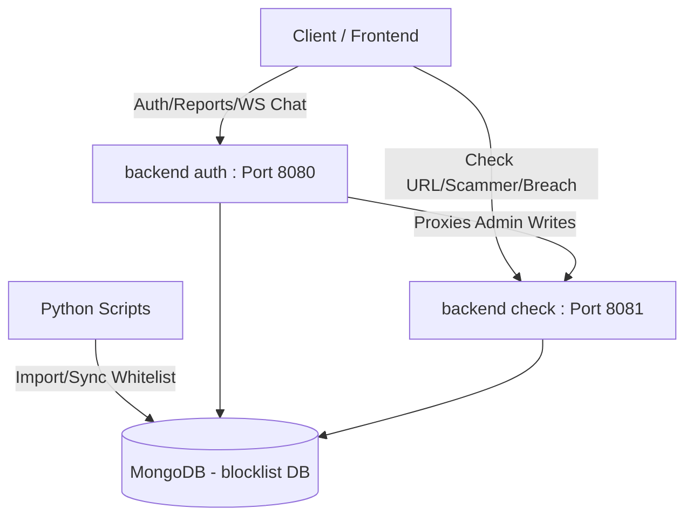

# Cấu trúc Thư mục Backend

Tài liệu này phân tích cấu trúc mã nguồn của thư mục `backend` trong dự án **User Privacy Protection Ecosystem**. Hệ thống được xây dựng theo kiến trúc **Microservices** nhỏ, sử dụng ngôn ngữ **Go** cho các dịch vụ chính và **Python** cho các công cụ cào/nhập dữ liệu.

---

## 📂 Tổng quan Thư mục
Thư mục `backend` bao gồm 3 thư mục chính:
1. [backend auth](file:///c:/Users/vkhai/OneDrive/Desktop/user%20privacy%20protection%20ecosystem/backend/backend%20auth): Dịch vụ xác thực và quản lý tài khoản người dùng.
2. [backend check](file:///c:/Users/vkhai/OneDrive/Desktop/user%20privacy%20protection%20ecosystem/backend/backend%20check): Dịch vụ kiểm tra và tra cứu URL độc hại / Kẻ lừa đảo (Scammer) hiệu năng cao.
3. [scripts](file:///c:/Users/vkhai/OneDrive/Desktop/user%20privacy%20protection%20ecosystem/backend/scripts): Các công cụ Python hỗ trợ cào dữ liệu từ trang chính thống và nạp vào cơ sở dữ liệu MongoDB.

---

---

## 🔐 1. backend auth (Authentication Service)
Dịch vụ đảm nhận đăng ký, đăng nhập, bảo mật danh tính (hỗ trợ Passkey/WebAuthn, OAuth mạng xã hội), quản lý báo cáo (reports) từ người dùng và tính năng chat hỗ trợ qua WebSocket.

### 🛠️ Công nghệ sử dụng
- **Ngôn ngữ**: Go
- **Web Framework**: Gin
- **Xác thực**: JWT, WebAuthn (Passkey), OAuth2 (Google, GitHub, Microsoft, Telegram, Facebook, Apple)
- **Database**: MongoDB

### 📂 Cấu trúc chi tiết
- **[cmd/api/main.go](file:///c:/Users/vkhai/OneDrive/Desktop/user%20privacy%20protection%20ecosystem/backend/backend%20auth/cmd/api/main.go)**: Điểm khởi đầu (Entrypoint) của ứng dụng. Khởi tạo app từ package `bootstrap` và chạy HTTP server.
- **[bootstrap/app.go](file:///c:/Users/vkhai/OneDrive/Desktop/user%20privacy%20protection%20ecosystem/backend/backend%20auth/bootstrap/app.go)**: Liên kết toàn bộ tài nguyên: Đọc config, kết nối MongoDB, khởi tạo các Repository, Service, đăng ký các OAuth Provider, Handlers và thiết lập Router.
- **[config/](file:///c:/Users/vkhai/OneDrive/Desktop/user%20privacy%20protection%20ecosystem/backend/backend%20auth/config)**: Quản lý các biến môi trường và cấu hình hệ thống.
- **internal/**: Thư mục cốt lõi chứa logic nghiệp vụ theo cấu trúc Clean Architecture lai:
  - **domain/**: Định nghĩa các thực thể (Entities), interface.
  - **dto/**: Data Transfer Objects dùng để định nghĩa cấu trúc dữ liệu input/output của API.
  - **services/**: Chứa logic xử lý nghiệp vụ chính:
    - `auth/`: Đăng ký, đăng nhập, giải mã/tạo JWT Token, quản lý danh sách đen Token (blacklist).
    - `passkey/`: Đăng ký và đăng nhập bảo mật bằng vân tay/khuôn mặt qua WebAuthn.
    - `chat/`: Quản lý các kết nối WebSocket Chat Hub.
    - `report/`: Logic xử lý báo cáo các trang web lừa đảo do người dùng gửi lên.
  - **infrastructure/**: Triển khai kết nối database và các tích hợp bên ngoài (OAuth providers, database driver).
  - **http/**:
    - `handlers/`: Tiếp nhận HTTP request, gọi service tương ứng và trả về response.
    - `middleware/`: Các bộ lọc bảo mật như CORS, Rate Limiting (giới hạn tần suất gọi API), JWT Auth, IP Whitelist, kiểm tra quyền hạn (Role check).
    - `router/`: Định nghĩa danh sách các Endpoint của hệ thống.

---

## 🔍 2. backend check (Scan & Checker Service)
Dịch vụ tối ưu hiệu năng phục vụ việc kiểm tra tức thời (real-time check) xem một URL có nằm trong danh sách đen/trắng hay không, tìm kiếm thông tin kẻ lừa đảo, hoặc kiểm tra rò rỉ dữ liệu (data breach).

### 🛠️ Công nghệ sử dụng
- **Ngôn ngữ**: Go
- **Web Framework**: Gin
- **Cơ chế lọc nhanh**: Cuckoo Filter (đầu tiên truy vấn bộ lọc Cuckoo lưu trên RAM trước khi truy vấn xuống MongoDB để tăng tốc độ phản hồi).
- **Thư viện Whois**: Tra cứu thông tin tên miền.

### 📂 Cấu trúc chi tiết
- **[main.go](file:///c:/Users/vkhai/OneDrive/Desktop/user%20privacy%20protection%20ecosystem/backend/backend%20check/main.go)**: Khởi động service, kết nối DB, nạp dữ liệu URL whitelist/blacklist vào bộ lọc Cuckoo Filter (`cuckoo.InitURLFilter`) để tối ưu hóa hiệu năng truy vấn, cấu hình Graceful Shutdown.
- **internal/**:
  - **config/**: Nạp cấu hình từ `.env`.
  - **interfaces/**:
    - **router/api/**: Đăng ký các router phân mảnh theo tính năng:
      - `url.go`: Đăng ký API kiểm tra URL công khai (`/urls/check`) và API quản trị để đồng bộ danh sách URL độc hại.
      - `scamuser.go`: API kiểm tra thông tin kẻ lừa đảo (`/scammers/check`).
      - `search.go`: API gợi ý tự động (`/search/suggestions`), kiểm tra chung (`/check`), và tra cứu thông tin WHOIS (`/urls/whois`).
      - `breach.go`: API kiểm tra rò rỉ email (`/check-breach/email`).
    - **handlers/**: Logic tiếp nhận request cho các API tương ứng.
    - **middleware/**: Giới hạn Payload size, CORS, bảo mật headers, giới hạn Rate Limit cực kỳ chặt chẽ cho các API tìm kiếm và kiểm tra.
  - **services/**: Chứa logic cốt lõi để chuẩn hóa URL, kiểm tra qua Cuckoo Filter, cache kết quả, kiểm tra tài khoản lừa đảo.
  - **infrastructure/**:
    - `cuckoo/`: Triển khai Cuckoo Filter lưu trên bộ nhớ trong (In-memory filter) phục vụ so khớp siêu tốc.
    - `cache/`: Quản lý bộ nhớ đệm (Memory cache) kết quả kiểm tra URL để tránh truy vấn DB lặp lại.
    - `database/`: Kết nối và cấu hình MongoDB.

---

## 🐍 3. scripts (Data Utilities)
Thư mục chứa các script Python tự động hóa hỗ trợ quản trị viên thu thập và import nhanh danh sách tên miền tin cậy hoặc danh sách đen vào MongoDB.

- **[crawl_tinnhiemmang.py](file:///c:/Users/vkhai/OneDrive/Desktop/user%20privacy%20protection%20ecosystem/backend/scripts/crawl_tinnhiemmang.py)**: Sử dụng crawler đa luồng (`ThreadPoolExecutor`) cào danh sách các tên miền được tin tưởng (whitelist) từ Cổng tin nhiệm mạng Quốc gia (`tinnhiemmang.vn`) và lưu trực tiếp vào collection `whitelist` của MongoDB.
- **[import.py](file:///c:/Users/vkhai/OneDrive/Desktop/user%20privacy%20protection%20ecosystem/backend/scripts/import.py)**: Đọc tệp CSV chứa danh sách tên miền (ví dụ: top 1 triệu tên miền phổ biến) và sử dụng đa luồng để đẩy nhanh lượng lớn dữ liệu vào MongoDB với cơ chế bỏ qua trùng lặp (Duplicate Key Error).
- **[jsonn.py](file:///c:/Users/vkhai/OneDrive/Desktop/user%20privacy%20protection%20ecosystem/backend/scripts/jsonn.py)**: Tương tự như `import.py` nhưng dùng để import các tệp định dạng JSON.

---

## 💡 Điểm đặc sắc trong kiến trúc
1. **Chia tách Authentication & Heavy Check Service**: Dịch vụ `backend auth` chịu trách nhiệm nặng nề về bảo mật tài khoản/passkey, trong khi `backend check` được tinh chỉnh tối đa cho tốc độ truy vấn cao (được hỗ trợ bởi In-memory Cuckoo Filter & Memory Cache).
2. **Đồng bộ Dữ liệu**: Khi quản trị viên thêm URL độc hại hoặc Scammer qua bảng điều khiển Admin (kết nối với `backend auth`), dịch vụ `backend auth` sẽ gọi proxy/đồng bộ sang `backend check` để cập nhật vào cơ sở dữ liệu chung và nạp lại vào bộ lọc Cuckoo Filter.
3. **Bảo mật Đa tầng**:
   - Tự động cấu hình các tiêu đề bảo mật (Secure HTTP Headers) và kiểm soát CORS nghiêm ngặt.
   - Sử dụng Rate Limit khác biệt cho từng loại Endpoint (ví dụ: đăng ký/đăng nhập bị giới hạn chặt hơn so với API gõ tìm kiếm tự động).
   - Bộ lọc kích thước Body tối đa (Max Body Size) để chống các cuộc tấn công DDoS dạng Payload lớn.
