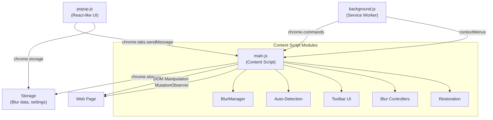

# DataBlur Extension - Phân Tích Source Code & Kế Hoạch Tích Hợp

## 📋 Tổng quan Extension

| Thông tin | Chi tiết |
|-----------|----------|
| **Tên** | DataBlur - Screen Blur for Privacy |
| **Version** | 2.4.3 |
| **ID** | `fnjoejcjefolmkdnmbdpafijmjdoaodp` |
| **Permissions** | `storage`, `contextMenus`, `tabs` |
| **Kiến trúc** | Minified/bundled (React popup + vanilla JS content script) |

---

## 🔑 Danh sách tính năng chính

### 1. 🎯 Ba loại Blur (Blur Types)

| Loại | Cách hoạt động |
|------|---------------|
| **Element Blur** | Click vào bất kỳ element nào → blur toàn bộ element đó (CSS `filter: blur()`) |
| **Area Blur** | Kéo chọn vùng (area) trên trang → tạo overlay `backdrop-filter: blur()` đè lên vùng đó |
| **Text Blur** | Bôi đen văn bản → chỉ blur đoạn text đã chọn |

### 2. 🤖 Auto-Detection (Tự động phát hiện PII)

Extension có thể tự động phát hiện và blur các loại dữ liệu nhạy cảm sau (gọi là **PII Categories**):

| Category Key | Tên hiển thị | Mặc định |
|-------------|-------------|---------|
| `email` | Emails | ✅ Bật |
| `phone` | Phone numbers | ✅ Bật |
| `ssn` | SSN (Social Security Number) | ❌ Tắt |
| `password` | Passwords | ❌ Tắt |
| `creditCard` | Credit cards | ❌ Tắt |
| `secretKeys` | Secret keys | ❌ Tắt |
| `money` | Money amounts | ❌ Tắt |
| `cryptoWallet` | Crypto wallets | ❌ Tắt |
| `high-entropy` | High-entropy strings | ❌ Tắt |

> [!IMPORTANT]
> Auto-detection sử dụng regex phức tạp (bao gồm cả danh sách mã vùng điện thoại quốc tế + Luhn validation cho credit card) thay vì regex đơn giản.

### 3. 📝 Keywords Blur (Blocklist)

- Người dùng nhập danh sách từ khóa (phân cách bằng dấu phẩy)
- Extension tự động blur mọi đoạn text khớp trên trang
- Ví dụ: tên khách hàng, email cụ thể, mã dự án
- Hỗ trợ **case-sensitive** option
- Auto-save khi nhập dấu phẩy (debounce 500ms)

### 4. 🔧 Floating Toolbar

Toolbar nổi (fixed position) ở dưới cùng trang web với các nút:

- **Element Blur** mode (click-to-blur)
- **Area Blur** mode (drag-to-blur)
- **Text Blur** mode (select-to-blur)
- **Auto-detect** toggle
- **Blur intensity slider** (điều chỉnh mức blur)
- **Remove all blurs** button
- **Toggle toolbar visibility** (Alt+Shift+T)

### 5. 🏠 Blur per Domain (Host/Path Scoping)

- Blur có thể được lưu theo **hostname** (áp dụng cho toàn domain)
- Hoặc theo **pathname** (chỉ áp dụng cho URL cụ thể)
- Toggle **"Apply to host"** / **"Apply to path"** trên mỗi blur controller

### 6. 📌 Blur Persistence & Restoration

- Mọi blur được lưu vào `chrome.storage.local` theo cấu trúc:
  - `blurManagerItems`: Map chứa tất cả blur data
  - `blurManagerItemsOfPathname`: Index theo pathname
  - `blurManagerItemsOfHostname`: Index theo hostname
- Khi reload trang → restore toàn bộ blur đã lưu
- Sử dụng `pre-hide.css` (`body { visibility: hidden }`) để tránh FOUC (Flash of Unstyled Content)
- `sessionStorage` cache cho blur nhanh

### 7. ⌨️ Keyboard Shortcuts

| Shortcut | Hành động |
|----------|----------|
| `Alt+Shift+T` | Show/hide toolbar |
| `Alt+Shift+B` | Blur highlighted text |
| `Alt+Shift+A` | Toggle auto-detect |
| `Alt+Shift+R` | Remove all blurs |

### 8. 🌐 Site-level Enable/Disable

- Có thể tắt extension **globally** (`blurManagerDisabled`)
- Hoặc tắt theo **hostname** cụ thể (`blurManagerDisabledHostnames`)

### 9. 📊 Document Title Blur

- Blur luôn title tab trình duyệt để bảo mật khi chia sẻ màn hình

### 10. 🔗 Context Menu

- Right-click → menu "Blur" cho element/text đang chọn

### 11. 📈 Analytics (PostHog)

- Tích hợp PostHog analytics (có thể tắt)
- Tracking extension usage events

---

## 🏗️ Kiến trúc kỹ thuật

### Storage Keys quan trọng:

| Key | Mô tả |
|-----|-------|
| `blurManagerItems` | Tất cả blur items (element/area/text) |
| `blurManagerItemsOfPathname` | Index blur theo URL path |
| `blurManagerItemsOfHostname` | Index blur theo hostname |
| `blurManagerDisabled` | Global enable/disable |
| `blurManagerDisabledHostnames` | List hostnames bị tắt |
| `autoDetectionEnabled` | Auto-detect on/off |
| `piiCategorySettings` | PII categories config |
| `blocklistSettings` | Keywords blocklist |
| `toolbarVisible` | Toolbar visibility state |
| `toolbarBlurMode` | Current blur mode |
| `globalBlurIntensity` | Blur intensity level |
| `isDocumentTitleBlurred` | Title blur state |

---

## 📐 Kế hoạch tích hợp vào KiGuard

### Tổng quan Strategy

> [!TIP]
> Thay vì copy 363KB minified code, mình sẽ **re-implement sạch** các tính năng cốt lõi vào KiGuard, sử dụng kiến trúc module sẵn có của KiGuard.

### Phase 1: Nâng cấp Auto-Detection (DataBlurShield.js)

Hiện tại `DataBlurShield.js` chỉ có 3 categories cơ bản. Cần mở rộng:

| Tính năng | Trạng thái | Cần làm |
|----------|-----------|--------|
| Email detection | ✅ Có rồi | Giữ nguyên |
| Phone detection | ✅ Có rồi | Nâng cấp regex (thêm phone DB quốc tế) |
| Credit card detection | ✅ Có rồi (credentials) | Thêm Luhn validation |
| SSN detection | ❌ Chưa có | Thêm mới |
| Password fields | ❌ Chưa có | Thêm mới |
| Secret keys (API keys) | ❌ Chưa có | Thêm mới |
| Money amounts | ❌ Chưa có | Thêm mới |
| Crypto wallets | ❌ Chưa có | Thêm mới |

### Phase 2: Element Blur (Click-to-Blur)

- Thêm **element blur mode** vào toolbar
- User click bất kỳ element → áp dụng `filter: blur(Npx)` lên element đó
- Lưu CSS selector vào storage để restore khi reload

### Phase 3: Area Blur (Drag-to-Blur)

- Thêm **area blur mode** vào toolbar
- User kéo chuột tạo vùng chọn → tạo overlay `backdrop-filter: blur()`
- Lưu position + size vào storage

### Phase 4: Text Blur (Select-to-Blur)

- User bôi đen text → blur chỉ đoạn text đó
- Wrap text trong ``

### Phase 5: Keywords Blocklist

- Thêm textarea trong popup để nhập keywords
- Content script tự scan DOM + blur matching text
- Auto-save với debounce

### Phase 6: Floating Toolbar

- Toolbar nổi ở bottom center trang web
- Các nút: Element/Area/Text mode, Auto-detect toggle, Intensity slider, Remove all

### Phase 7: Persistence & Restoration

- Lưu blur state vào `chrome.storage.local`
- Restore khi page load
- URL change detection (SPA support)

### Phase 8: Keyboard Shortcuts & Context Menu

- Đăng ký shortcuts trong manifest
- Context menu "Blur this element"

---

## 🗂️ File mapping cho tích hợp

| DataBlur | → KiGuard |
|----------|----------|
| `main.js` (content) | `src/content/modules/DataBlurShield.js` (mở rộng) |
| `main.css` (toolbar styles) | `src/content/content.css` (append) |
| `popup.js` (settings) | `src/popup/views/TrackingTab.vue` (mở rộng) |
| `background.js` (commands) | `src/background/background.js` (append) |
| `pre-hide.css` | Không cần (chỉ áp dụng khi DataBlur bật) |

---

## ❓ Câu hỏi cần xác nhận trước khi bắt đầu

1. **Ưu tiên phase nào trước?** (Auto-detection nâng cao? Element/Area blur? Keywords?)
2. **Có cần floating toolbar không?** Hay chỉ dùng popup toggle?
3. **Blur persistence**: Có cần lưu blur vĩnh viễn (như DataBlur) hay chỉ lưu session?
4. **Keyboard shortcuts**: Có muốn đăng ký shortcuts riêng cho KiGuard không?
5. **PII categories**: Muốn thêm tất cả 9 categories hay chỉ những cái phù hợp Việt Nam?
