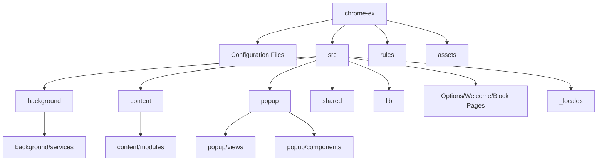

# KiGuard: Chrome Extension Architecture Walkthrough

This document outlines the directory structure, components, and communication flow of the **KiGuard** browser extension codebase.

---

## 📂 Project Directory Structure

Below is the directory tree of the extension (excluding dependencies, cache, and temporary/developer folders):

---

## ⚙️ Configuration & Build Files

These files are located at the root of the project:

*   **[manifest.json](file:///c:/Users/vkhai/OneDrive/Desktop/user%20privacy%20protection%20ecosystem/extension/chrome-ex/manifest.json)**:
    *   Declared as a Manifest V3 extension.
    *   Defines permissions (e.g., `proxy`, `storage`, `declarativeNetRequest`, `cookies`, `scripting`).
    *   Configures the background script, content scripts matching patterns (including target sites like Facebook), web accessible resources, declarative net request rules, and externally connectable domains (`https://cookie.kimidev.net/*`).
*   **[package.json](file:///c:/Users/vkhai/OneDrive/Desktop/user%20privacy%20protection%20ecosystem/extension/chrome-ex/package.json)**:
    *   Contains npm packages and scripts. Vue 3 (`vue`) is a runtime dependency, while `vite`, `tailwindcss`, and helper utilities are devDependencies.
*   **[vite.config.js](file:///c:/Users/vkhai/OneDrive/Desktop/user%20privacy%20protection%20ecosystem/extension/chrome-ex/vite.config.js)**:
    *   Configures the build using Vite, specifying the entry point for the Vue-based extension popup at [popup.html](file:///c:/Users/vkhai/OneDrive/Desktop/user%20privacy%20protection%20ecosystem/extension/chrome-ex/src/popup/popup.html).
*   **[build.js](file:///c:/Users/vkhai/OneDrive/Desktop/user%20privacy%20protection%20ecosystem/extension/chrome-ex/build.js)**:
    *   Build automation script. It runs Vite compiler for the popup frontend UI and then recursively copies all static assets, folders (background services, content scripts, locales, libraries, etc.) and configuration files to the release/distribution folder (`dist/`).
*   **[tailwind.config.js](file:///c:/Users/vkhai/OneDrive/Desktop/user%20privacy%20protection%20ecosystem/extension/chrome-ex/tailwind.config.js)** & **[postcss.config.js](file:///c:/Users/vkhai/OneDrive/Desktop/user%20privacy%20protection%20ecosystem/extension/chrome-ex/postcss.config.js)**:
    *   CSS framework configurations to styling with Tailwind.

---

## 🧠 Background Orchestration (`src/background/`)

The background directory contains the background service worker which executes in a separate thread, managing core events and backend logic.

*   **[background.js](file:///c:/Users/vkhai/OneDrive/Desktop/user%20privacy%20protection%20ecosystem/extension/chrome-ex/src/background/background.js)**:
    *   Coordinates the service worker setup, listens to runtime install/startup/alarm events, processes incoming runtime messages from content scripts/popups, and listens to cookies and external messages from allowed domains (`chrome.runtime.onMessageExternal`).
*   **`src/background/services/`**:
    *   **[ApiSync.js](file:///c:/Users/vkhai/OneDrive/Desktop/user%20privacy%20protection%20ecosystem/extension/chrome-ex/src/background/services/ApiSync.js)**: Syncs blocked website database lists from backend endpoints.
    *   **[GpcService.js](file:///c:/Users/vkhai/OneDrive/Desktop/user%20privacy%20protection%20ecosystem/extension/chrome-ex/src/background/services/GpcService.js)**: Manages Global Privacy Control logic.
    *   **[NavigationShield.js](file:///c:/Users/vkhai/OneDrive/Desktop/user%20privacy%20protection%20ecosystem/extension/chrome-ex/src/background/services/NavigationShield.js)**: Validates navigation domains and implements security blocks.
    *   **[ProxyAuthService.js](file:///c:/Users/vkhai/OneDrive/Desktop/user%20privacy%20protection%20ecosystem/extension/chrome-ex/src/background/services/ProxyAuthService.js)**: Configures proxy connections, handles authentication, and performs proxy health/speed tests.
    *   **[ProxyAdvancedService.js](file:///c:/Users/vkhai/OneDrive/Desktop/user%20privacy%20protection%20ecosystem/extension/chrome-ex/src/background/services/ProxyAdvancedService.js)**: Applies anti-fingerprinting details (customizing WebRTC, spoofing timezone/GPS).
    *   **[TrackingParamsService.js](file:///c:/Users/vkhai/OneDrive/Desktop/user%20privacy%20protection%20ecosystem/extension/chrome-ex/src/background/services/TrackingParamsService.js)**: Cleanses query parameter tracking parameters (e.g., Google click tracking IDs).

---

## 🛡️ Content Script Injection (`src/content/`)

Content scripts are injected directly into targeted browser tabs to modify site behavior and intercept attacks.

*   **[content.js](file:///c:/Users/vkhai/OneDrive/Desktop/user%20privacy%20protection%20ecosystem/extension/chrome-ex/src/content/content.js)**:
    *   Core content script loading protection modules and acting as the communication bridge between page modules and the background worker.
*   **[content.css](file:///c:/Users/vkhai/OneDrive/Desktop/user%20privacy%20protection%20ecosystem/extension/chrome-ex/src/content/content.css)**:
    *   Styling for page-level warning panels, modal windows, or blurred text boxes.
*   **[gpcWindowSetting.js](file:///c:/Users/vkhai/OneDrive/Desktop/user%20privacy%20protection%20ecosystem/extension/chrome-ex/src/content/gpcWindowSetting.js)**:
    *   Web-accessible resource that injects `navigator.globalPrivacyControl = true` into the main page execution environment.
*   **`src/content/modules/`**:
    *   **[ScamShield.js](file:///c:/Users/vkhai/OneDrive/Desktop/user%20privacy%20protection%20ecosystem/extension/chrome-ex/src/content/modules/ScamShield.js)**: Real-time detection of malicious web content.
    *   **[ClickjackingShield.js](file:///c:/Users/vkhai/OneDrive/Desktop/user%20privacy%20protection%20ecosystem/extension/chrome-ex/src/content/modules/ClickjackingShield.js)**: Scans for transparent iframe overlays and warns users.
    *   **[DataBlurShield.js](file:///c:/Users/vkhai/OneDrive/Desktop/user%20privacy%20protection%20ecosystem/extension/chrome-ex/src/content/modules/DataBlurShield.js)**: Obfuscates passwords, credit cards, or text fields from snooping and unauthorized screen capturing.
    *   **[FbWsHook.js](file:///c:/Users/vkhai/OneDrive/Desktop/user%20privacy%20protection%20ecosystem/extension/chrome-ex/src/content/modules/FbWsHook.js)**: Intercepts WebSocket communication on Facebook (e.g. keylogger blocking, chat details).

---

## 🎨 Interactive Interfaces (`src/popup/`)

The main interactive user interface loaded when a user clicks the extension toolbar icon. It is structured as a single page application (SPA) built using **Vue 3** and compiled via Vite.

*   **[popup.html](file:///c:/Users/vkhai/OneDrive/Desktop/user%20privacy%20protection%20ecosystem/extension/chrome-ex/src/popup/popup.html)**: Container template.
*   **[main.js](file:///c:/Users/vkhai/OneDrive/Desktop/user%20privacy%20protection%20ecosystem/extension/chrome-ex/src/popup/main.js)**: Vue app initiator.
*   **[App.vue](file:///c:/Users/vkhai/OneDrive/Desktop/user%20privacy%20protection%20ecosystem/extension/chrome-ex/src/popup/App.vue)**: Root layout control, including navigation menus and global state settings.
*   **`src/popup/views/` (Main tabs)**:
    *   **[DashboardTab.vue](file:///c:/Users/vkhai/OneDrive/Desktop/user%20privacy%20protection%20ecosystem/extension/chrome-ex/src/popup/views/DashboardTab.vue)**: Extension status overview, stats, and primary enable/disable switches.
    *   **[CookieManager.vue](file:///c:/Users/vkhai/OneDrive/Desktop/user%20privacy%20protection%20ecosystem/extension/chrome-ex/src/popup/views/CookieManager.vue)**: Multi-profile cookie importer, viewer, editor, and exporter.
    *   **[ProxyTab.vue](file:///c:/Users/vkhai/OneDrive/Desktop/user%20privacy%20protection%20ecosystem/extension/chrome-ex/src/popup/views/ProxyTab.vue)**: Controls proxy lists, custom connection configuration, and testing.
    *   **[AuthenticatorTab.vue](file:///c:/Users/vkhai/OneDrive/Desktop/user%20privacy%20protection%20ecosystem/extension/chrome-ex/src/popup/views/AuthenticatorTab.vue)**: Integrated 2FA authentication manager (generating TOTP codes).
    *   **[StatsTab.vue](file:///c:/Users/vkhai/OneDrive/Desktop/user%20privacy%20protection%20ecosystem/extension/chrome-ex/src/popup/views/StatsTab.vue)**: Charts and visualization of blocked telemetry.
    *   **[SettingsTab.vue](file:///c:/Users/vkhai/OneDrive/Desktop/user%20privacy%20protection%20ecosystem/extension/chrome-ex/src/popup/views/SettingsTab.vue)**: Extra customizations for privacy filters and APIs.
    *   **[AdblockTab.vue](file:///c:/Users/vkhai/OneDrive/Desktop/user%20privacy%20protection%20ecosystem/extension/chrome-ex/src/popup/views/AdblockTab.vue)**, **[AdvisorTab.vue](file:///c:/Users/vkhai/OneDrive/Desktop/user%20privacy%20protection%20ecosystem/extension/chrome-ex/src/popup/views/AdvisorTab.vue)**, **[SearchTab.vue](file:///c:/Users/vkhai/OneDrive/Desktop/user%20privacy%20protection%20ecosystem/extension/chrome-ex/src/popup/views/SearchTab.vue)**, **[TrackingTab.vue](file:///c:/Users/vkhai/OneDrive/Desktop/user%20privacy%20protection%20ecosystem/extension/chrome-ex/src/popup/views/TrackingTab.vue)**: Controls for specialized sub-features.
*   **`src/popup/components/` (Interactive overlay modals)**:
    *   **[TermsOverlay.vue](file:///c:/Users/vkhai/OneDrive/Desktop/user%20privacy%20protection%20ecosystem/extension/chrome-ex/src/popup/components/TermsOverlay.vue)**: Rules agreement modal shown on first launch.
    *   **[FeedbackOverlay.vue](file:///c:/Users/vkhai/OneDrive/Desktop/user%20privacy%20protection%20ecosystem/extension/chrome-ex/src/popup/components/FeedbackOverlay.vue)**: User feedback collection card.
    *   **[CwsOverlay.vue](file:///c:/Users/vkhai/OneDrive/Desktop/user%20privacy%20protection%20ecosystem/extension/chrome-ex/src/popup/components/CwsOverlay.vue)**: Overlay for handling interaction with the Chrome Web Store.

---

## 🛠️ Specialized Utilities & Assets

*   **`src/shared/`**:
    *   **[crx.js](file:///c:/Users/vkhai/OneDrive/Desktop/user%20privacy%20protection%20ecosystem/extension/chrome-ex/src/shared/crx.js)**: Helper scripts for managing native Chrome elements.
    *   **[crypto.js](file:///c:/Users/vkhai/OneDrive/Desktop/user%20privacy%20protection%20ecosystem/extension/chrome-ex/src/shared/crypto.js)**: Cryptographic routines (hashing, symmetric key encryption).
    *   **[storage.js](file:///c:/Users/vkhai/OneDrive/Desktop/user%20privacy%20protection%20ecosystem/extension/chrome-ex/src/shared/storage.js)**: Local/sync database wrapper logic.
    *   **[toast.js](file:///c:/Users/vkhai/OneDrive/Desktop/user%20privacy%20protection%20ecosystem/extension/chrome-ex/src/shared/toast.js)**: Non-blocking notifications.
*   **`src/lib/`**:
    *   Contains dependency libraries utilized by features (e.g., `jsQR` for scanning QR codes in `AuthenticatorTab`, `jszip` for compressing/downloading extension archives, and `prism` for showing highlighted source files in the source viewer options page).
*   **`rules/`**:
    *   **[rules.json](file:///c:/Users/vkhai/OneDrive/Desktop/user%20privacy%20protection%20ecosystem/extension/chrome-ex/rules/rules.json)**: Declarative Net Request filters defining rules to block or redirect malicious/tracking domains at the network stack.
*   **`src/_locales/`**:
    *   Vietnamese (`vi`) and English (`en`) JSON resources supporting native translation.
