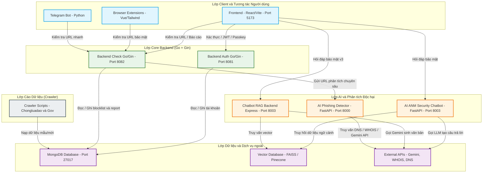
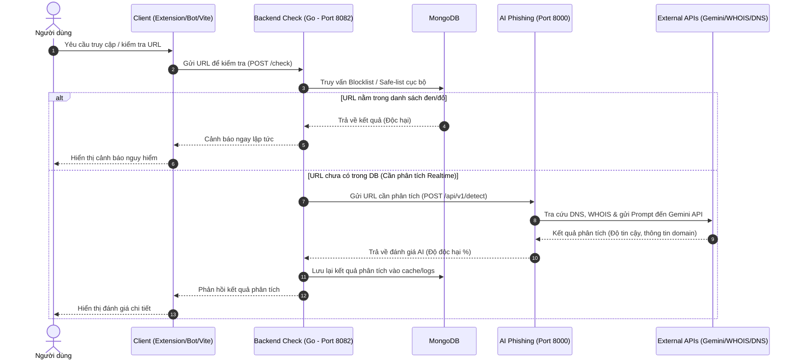

# 🛡️ Tổng Quan Hệ Sinh Thái Bảo Vệ Người Dùng & Quyền Riêng Tư (KiGuard Ecosystem)

Hệ thống **KiGuard Ecosystem** là một giải pháp tích hợp đa nền tảng nhằm bảo vệ người dùng trước các mối đe dọa trực tuyến (phishing, malware, scam URLs). Hệ sinh thái kết hợp các giao diện người dùng tiện lợi, các API backend hiệu năng cao, dịch vụ AI phân tích thông minh và các bot tự động hóa.

---

## 📐 Sơ Đồ Kiến Trúc Tổng Quan (System Architecture)

Dưới đây là mô hình phân tầng kiến trúc của hệ thống, thể hiện cách các thành phần tương tác với nhau:

---

## 🔄 Luồng Dữ Liệu Kiểm Tra URL (URL Verification Flow)

Khi người dùng kiểm tra một đường dẫn thông qua Trình duyệt (Extension), Telegram Bot hoặc Dashboard Web, luồng xử lý diễn ra như sau:

---

## 🗂️ Chi Tiết Các Thành Phần (Component Breakdown)

| Thành phần | Đường dẫn | Công nghệ | Cổng mặc định | Mô tả & Chức năng chính |
| :--- | :--- | :--- | :--- | :--- |
| **Frontend** | [frontend](file:///c:/Users/vkhai/OneDrive/Desktop/user%20privacy%20protection%20ecosystem/frontend) | React, Vite, CSS | `5173` | Dashboard quản trị dành cho Admin & giao diện người dùng để theo dõi thống kê, báo cáo URL độc hại và tích hợp giao diện Chatbot an ninh. |
| **Backend Auth** | [backend/backend auth](file:///c:/Users/vkhai/OneDrive/Desktop/user%20privacy%20protection%20ecosystem/backend/backend%20auth) | Go, Gin, JWT, WebAuthn | `8081` | Hệ thống quản lý người dùng, đăng ký, đăng nhập và tích hợp công nghệ xác thực không mật khẩu Passkey (WebAuthn). |
| **Backend Check** | [backend/backend check](file:///c:/Users/vkhai/OneDrive/Desktop/user%20privacy%20protection%20ecosystem/backend/backend%20check) | Go, Gin | `8082` | Xử lý kiểm tra danh sách đen/danh sách trắng của các URL, chuẩn hóa đường dẫn, nhận diện Heuristic, ghi nhận báo cáo từ người dùng. |
| **AI Phishing** | [Ai](file:///c:/Users/vkhai/OneDrive/Desktop/user%20privacy%20protection%20ecosystem/Ai) / [Aia/Ai](file:///c:/Users/vkhai/OneDrive/Desktop/user%20privacy%20protection%20ecosystem/Aia/Ai) | Python, FastAPI, Gemini API | `8000` | Dịch vụ phân tích tự động URL lừa đảo (phishing) sử dụng AI kết hợp kiểm tra thông tin DNS/WHOIS của tên miền. |
| **AI ANM** | [ai_ANM](file:///c:/Users/vkhai/OneDrive/Desktop/user%20privacy%20protection%20ecosystem/ai_ANM) | Python, FastAPI, Gemini 2.5 Flash, Pinecone Vector DB, Multilingual E5 | `8000` / `8003` | Hệ thống Agentic RAG tư vấn An ninh mạng & Pháp luật An toàn thông tin, tích hợp Pinecone Cloud Vector DB (namespaces `law` & `scam`) và Google Gemini API. |
| **Chatbot v3** | [chatbot v3](file:///c:/Users/vkhai/OneDrive/Desktop/user%20privacy%20protection%20ecosystem/chatbot%20v3) | Node.js, Express, Pinecone, Gemini | `8003` *(hoặc thay thế)* | Dịch vụ backend chatbot RAG đa trợ lý (multi-agent) hỗ trợ các "persona" khác nhau với kho dữ liệu lớn lưu trên Pinecone Vector DB. |
| **Extensions** | [extension](file:///c:/Users/vkhai/OneDrive/Desktop/user%20privacy%20protection%20ecosystem/extension) | Vue.js, TailwindCSS | *Trình duyệt* | Tiện ích bảo vệ đa năng tích hợp 11 tab/view chức năng: Tự động chặn tên miền độc hại, chặn quảng cáo & theo dõi (Adblock/Tracking), trợ lý chat Advisor trực tiếp, Cookie Manager chống cướp phiên, VPN/Proxy Router ẩn danh IP, làm mờ dữ liệu nhạy cảm (DataBlurShield), clickjacking shield, và lá chắn WebSocket chuyên biệt Facebook (FbWsHook). |
| **Telegram Bot** | [bot](file:///c:/Users/vkhai/OneDrive/Desktop/user%20privacy%20protection%20ecosystem/bot) | Python | *Polling / Webhook* | Hỗ trợ người dùng kiểm tra nhanh các URL độc hại ngay trong chat room Telegram. |
| **Crawler** | [crawl chongluadao](file:///c:/Users/vkhai/OneDrive/Desktop/user%20privacy%20protection%20ecosystem/crawl%20chongluadao) | Python | *CLI* | Script tự động cào dữ liệu từ cổng ChongLuaDao và Cổng thông tin chính phủ để bổ sung dữ liệu cơ sở dữ liệu. |

---

## 🛠️ Hướng Dẫn Phát Triển Nhanh (Quick Start)

> [!IMPORTANT]
> Trước khi khởi chạy toàn bộ hệ thống, hãy đảm bảo **MongoDB** đã được khởi chạy trên cổng `27017` và bạn đã tạo đầy đủ file cấu hình `.env` cho mỗi dịch vụ dựa trên `.env.example` tương ứng.

1. **Khởi động Cơ sở dữ liệu**:
   Đảm bảo MongoDB đang hoạt động cục bộ hoặc từ xa.
2. **Khởi chạy Core Backends**:
   - Chạy [backend check](file:///c:/Users/vkhai/OneDrive/Desktop/user%20privacy%20protection%20ecosystem/backend/backend%20check) qua lệnh `go run main.go` (Cổng `8082`).
   - Chạy [backend auth](file:///c:/Users/vkhai/OneDrive/Desktop/user%20privacy%20protection%20ecosystem/backend/backend%20auth) qua lệnh `go run cmd/api/main.go` (Cổng `8081`).
3. **Khởi chạy Các Dịch vụ AI**:
   - Chạy [AI Phishing Detector](file:///c:/Users/vkhai/OneDrive/Desktop/user%20privacy%20protection%20ecosystem/Ai) qua lệnh `uvicorn main:app --port 8000`.
   - Chạy [AI ANM Chatbot](file:///c:/Users/vkhai/OneDrive/Desktop/user%20privacy%20protection%20ecosystem/ai_ANM) qua lệnh `python main.py --api` (Cổng `8003`).
4. **Khởi chạy Giao diện Frontend**:
   - Chạy [frontend](file:///c:/Users/vkhai/OneDrive/Desktop/user%20privacy%20protection%20ecosystem/frontend) qua lệnh `npm run dev` (Cổng `5173`).
